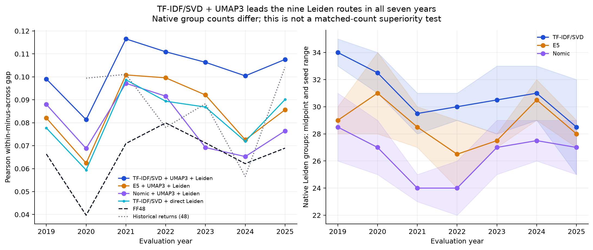

# Portfolio Theory in Practice

**FE5108 group project: portfolio choice, CAPM, factor models and investment judgment.**

The project uses **30 US stocks**, one per end-2024 text class, selected by **largest December 31, 2024 company market capitalization among members with 108 complete monthly return observations**. Stage 1 includes monthly data, mean vectors, covariance matrices, weights and separate subsample tables for this universe.

## Research design

1. Reuse the existing four-section TF-IDF/SVD → UMAP3 → Leiden classification at end-2024 (representative seed 20260831; 30 classes).
2. Rank each class by historical December 31, 2024 market capitalization. Select its largest member with complete January 2017–December 2025 daily-return coverage. No centrality-rank cutoff is applied.
3. Freeze all 30 securities and compound daily total returns to 108 monthly observations.
4. Estimate monthly arithmetic means, sample covariance and unconstrained tangency weights over 108, 96 and 84 months. Compare with fixed **December 31, 2025** capitalization weights in the same universe.
5. Continue CAPM and additional-factor analyses using the shared monthly inputs. The distance-matrix allocation experiments are separate research, not the Stage 1 weighting formula.

This is a retrospectively constructed course universe. Full-history screening, 2024 classifications applied to earlier returns and retrospective method choices preclude a strict point-in-time investment claim. Historical vendor capitalization is not independently certified; see [selection](docs/03-universe-selection.md) and [endpoint audit](artifacts/stage1/market_cap_audit.md).

## Frozen universe

SHW, AAPL, ABBV, PLD, TMO, SF, VZ, META, SCCO, MSFT, UPS, WMT, PANW, RTX, AFL, ACN, V, EXEL, KO, UNH, WMB, MO, AGNC, CME, SRE, MAR, CMG, TSLA, SLB, DHI.

[Selected companies, cap ranks and coverage](artifacts/results/selected_universe.csv) · [All 30 class representatives](artifacts/results/candidates_30.csv) · [All 1,910 company rankings](artifacts/results/all_company_rankings_2024.csv).

Twenty-three selected stocks are their classes' absolute vendor-cap leaders. Seven classes use the largest complete-history member instead. The selected fallback ranks are 2–4; these are market-cap ranks, not centrality ranks. All 30 have 108 complete months.

## Classification evidence

The underlying classification evidence is unchanged. In the matched 48-group study, lexical four-section TF-IDF/SVD exceeds FF48 on Pearson and empirical lower-tail gaps in seven evaluated years. Native-count TF-IDF/SVD + UMAP3 + Leiden leads the nine studied Leiden routes on next-year Pearson gap in those seven years, and beats the historical-return control in five of six comparable years. Group counts vary; these descriptive results do not prove investment outperformance. The multi-text gain is representation-dependent.



[Detailed comparisons and qualifications](docs/02-classification-evidence.md).

## Shared data and Stage 1

- [Monthly total returns](artifacts/monthly/monthly_total_returns.csv): 108 months × 30 stocks, decimals.
- [Monthly excess returns](artifacts/monthly/monthly_excess_returns.csv), [aligned RF](artifacts/monthly/risk_free_monthly.csv), and [security-level long table](artifacts/monthly/monthly_returns_long.csv).
- [Stage 1 report](artifacts/stage1/README.md): full-sample and separate subsample weight tables, mean vectors, full covariance matrices and charts. The 30 × 30 matrices are small enough to remain uncompressed.
- [2024 selection capitalization](artifacts/inputs/formation_market_caps_2024.csv) and [2025 endpoint capitalization](artifacts/input/year_end_market_cap_2025.csv) serve different purposes. Sanitized endpoint detail responses and selected raw closes are versioned.

Daily market panels, raw SEC text and credentials remain local and excluded from Git. The daily input spans September 30, 2016–December 31, 2025, with first finite return October 3, 2016; the project uses the nine full years 2017–2025. See [data processing](docs/01-data.md) and [artifact documentation](artifacts/README.md).

## Reproduce

```bash
python -m pip install -r requirements.txt
python run_all.py --stage1
python -m unittest discover -s tests -v
```

This reproduces selection, evidence figures and Stage 1 from committed inputs without network access. It does not refit the upstream text models. To rebuild monthly returns and verify all candidate coverage from local daily panels:

```bash
python run_all.py --daily-root ./tbic_returns --monthly --stage1
```

The historical-cap inputs are frozen, not downloaded by the main program. [Provenance](artifacts/inputs/provenance.json) and generated verification files record hashes.

## Project status

| Stage | Status |
|---|---|
| Data and universe | Complete: 30 capitalization-selected representatives |
| Stage 1 | Complete: moments, static weights and subsample sensitivity |
| Stage 2: CAPM | Planned; select and document market proxy |
| Stage 3: factors | Planned; supply at least two additional factors |
| Stage 4: investment judgment | Planned |

[Next-stage contracts](docs/04-next-steps.md) · [Team contributions](docs/contributions.md).

## Attribution

Upstream text and return research: TBIC / Tuoyuan. Market data: Massive; filings: SEC EDGAR; historical universe proxy: iShares IWV; standard industry control: SIC-based FF48; RF: Kenneth French Data Library. OpenAI Codex assisted with code, auditing and documentation. The team remains responsible for interpretation and source limitations. This is a course research project, not investment advice.

## Research branch: 2026 tracking

This branch extends the main 30-stock project with [2026 tracking](research_2026/README.md), [Ledoit–Wolf sensitivity](research_2026/ledoit_wolf/README.md) and [text allocation comparisons](research_2026/text_weight/README.md). All use the same capitalization-selected basket.
