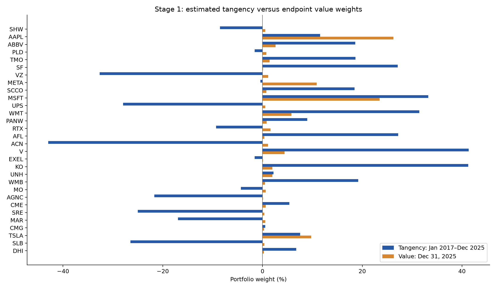
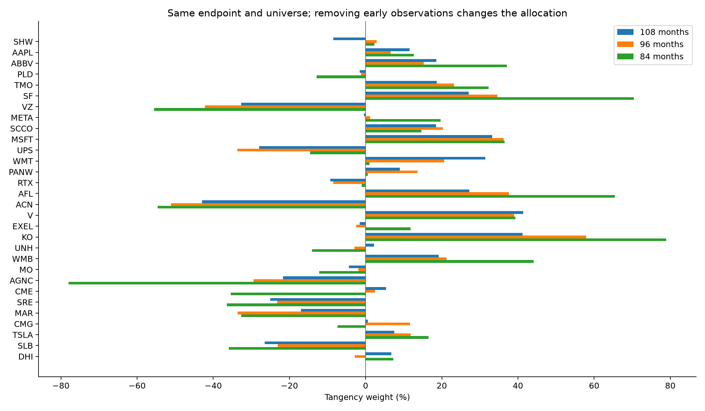

# Stage 1 — Portfolio choice

The 30-asset universe has 108 complete monthly total-return observations from January 2017 through December 2025. The comparison uses one fixed capitalization snapshot dated December 31, 2025, not monthly rebalancing.

## Method

Estimate the arithmetic monthly mean vector and unbiased sample covariance of total returns (ddof=1). Subtract the sample mean monthly risk-free rate to obtain the mean excess-return vector. Solve Sigma z = mu_e and normalize w = z / sum(z). Short positions are permitted in the textbook baseline. Market-value weights equal each company's original Massive capitalization divided by the total of the same 30 companies. Company-level capitalization includes convertible ordinary classes where applicable; it is not a float-adjusted index.

## Mean vectors and covariance matrices

All estimation uses monthly decimal returns. The arithmetic mean is mu_i = sum(r_it)/T; mean excess return is mu_e,i = mu_i - mean(r_f). Sample covariance is Sigma_ij = sum[(r_it-mu_i)(r_jt-mu_j)]/(T-1). The covariance uses total stock returns. No geometric averaging is used. Displayed mean returns are percentages; downloadable CSVs retain decimals. Covariance entries are decimal-return squared, not correlations.

### 108-month estimated moments

[Download mean vector](means_108m.csv) · [Download full 30 × 30 covariance matrix](covariance_monthly_108m.csv)

| Stock | Mean monthly return | Mean monthly excess return |
|---|---:|---:|
| SHW | 1.5537% | 1.3621% |
| AAPL | 2.4857% | 2.2941% |
| ABBV | 1.8320% | 1.6404% |
| PLD | 1.3235% | 1.1319% |
| TMO | 1.5700% | 1.3784% |
| SF | 1.7075% | 1.5159% |
| VZ | 0.3253% | 0.1337% |
| META | 2.1920% | 2.0005% |
| SCCO | 2.2549% | 2.0634% |
| MSFT | 2.1861% | 1.9945% |
| UPS | 0.5087% | 0.3171% |
| WMT | 1.7644% | 1.5728% |
| PANW | 2.5625% | 2.3709% |
| RTX | 0.9470% | 0.7555% |
| AFL | 1.4672% | 1.2757% |
| ACN | 1.1407% | 0.9491% |
| V | 1.6248% | 1.4333% |
| EXEL | 1.6825% | 1.4909% |
| KO | 0.8605% | 0.6689% |
| UNH | 1.1114% | 0.9199% |
| WMB | 1.3870% | 1.1954% |
| MO | 0.6680% | 0.4765% |
| AGNC | 0.9019% | 0.7103% |
| CME | 1.2384% | 1.0468% |
| SRE | 0.9534% | 0.7618% |
| MAR | 1.7695% | 1.5779% |
| CMG | 1.9715% | 1.7799% |
| TSLA | 4.8568% | 4.6652% |
| SLB | 0.3122% | 0.1206% |
| DHI | 2.2023% | 2.0107% |

Complete covariance matrix (30 rows × 30 columns; horizontally scrollable)

| Stock | SHW | AAPL | ABBV | PLD | TMO | SF | VZ | META | SCCO | MSFT | UPS | WMT | PANW | RTX | AFL | ACN | V | EXEL | KO | UNH | WMB | MO | AGNC | CME | SRE | MAR | CMG | TSLA | SLB | DHI |
|---|---:|---:|---:|---:|---:|---:|---:|---:|---:|---:|---:|---:|---:|---:|---:|---:|---:|---:|---:|---:|---:|---:|---:|---:|---:|---:|---:|---:|---:|---:|
| SHW | 0.00565828 | 0.00234257 | 0.00150554 | 0.00346269 | 0.0025995 | 0.00271738 | 0.000849795 | 0.00284522 | 0.00213566 | 0.00179921 | 0.00281682 | 0.0015696 | 0.00250703 | 0.00148689 | 0.00218442 | 0.00309119 | 0.00204831 | 0.00214648 | 0.00167608 | 0.00222502 | 0.00227423 | 0.001665 | 0.00326722 | 0.000757433 | 0.00161788 | 0.00308249 | 0.00228288 | 0.00337651 | 0.00290895 | 0.0058032 |
| AAPL | 0.00234257 | 0.00642791 | 0.000665935 | 0.0027225 | 0.00206057 | 0.00181714 | 0.000494236 | 0.00300978 | 0.0024537 | 0.00258122 | 0.00259065 | 0.00141162 | 0.00376987 | 0.00100745 | 0.00140407 | 0.00297237 | 0.0022092 | -0.00018081 | 0.000905323 | 0.00177243 | 0.00148837 | 0.00175707 | 0.00241799 | 0.000435335 | 0.0015688 | 0.00294892 | 0.00313018 | 0.00814848 | 0.00255334 | 0.00338268 |
| ABBV | 0.00150554 | 0.000665935 | 0.00557112 | 0.0010727 | 0.00105576 | 0.00174937 | 0.000567784 | 0.000625791 | 0.00185475 | 0.000668579 | 0.00151007 | 0.000309648 | 0.0013154 | 0.00166272 | 0.0019785 | 0.00153807 | 0.00129972 | 0.00209277 | 0.00100288 | 0.00200331 | 0.0015213 | 0.0006714 | 0.00134438 | 0.00110586 | 0.000355139 | 0.00214409 | -2.7139e-06 | 0.000488938 | 0.00303141 | 0.00219506 |
| PLD | 0.00346269 | 0.0027225 | 0.0010727 | 0.00531003 | 0.00304278 | 0.00244461 | 0.000664745 | 0.00301859 | 0.00178927 | 0.00190563 | 0.00281708 | 0.00173818 | 0.00161717 | 0.000987781 | 0.00147054 | 0.00322084 | 0.00169038 | 0.00213807 | 0.00140728 | 0.00185252 | 0.00162551 | 0.00101349 | 0.00305649 | 0.000569094 | 0.00182828 | 0.00229594 | 0.00200626 | 0.00371125 | 0.00215785 | 0.00416914 |
| TMO | 0.0025995 | 0.00206057 | 0.00105576 | 0.00304278 | 0.00471131 | 0.00198384 | 0.000525412 | 0.00214094 | 0.00237165 | 0.00165436 | 0.0023628 | 0.000986254 | 0.000721878 | 0.000475949 | 0.000826781 | 0.00227063 | 0.00102569 | 0.000943265 | 0.000833332 | 0.00170179 | 0.00125882 | 0.00025241 | 0.00251959 | -0.000220055 | 0.001424 | 0.00144843 | 0.00194955 | 0.00342128 | 0.00170197 | 0.00349753 |
| SF | 0.00271738 | 0.00181714 | 0.00174937 | 0.00244461 | 0.00198384 | 0.00717807 | 0.00101837 | 0.00272804 | 0.00376845 | 0.00165798 | 0.00269944 | 0.00100048 | 0.00304811 | 0.00323873 | 0.00272024 | 0.00272114 | 0.0025554 | 0.00179978 | 0.000884806 | 0.000926714 | 0.00344574 | 0.00139117 | 0.00376643 | 0.000931005 | 0.0015844 | 0.00513332 | 0.00206936 | 0.00342421 | 0.00666942 | 0.00405838 |
| VZ | 0.000849795 | 0.000494236 | 0.000567784 | 0.000664745 | 0.000525412 | 0.00101837 | 0.0026566 | 0.000714177 | 0.000773417 | 0.000684404 | 0.00115718 | 0.0008284 | 0.000313019 | 0.00104529 | 0.00125548 | 0.000819573 | 0.00121369 | 0.000515995 | 0.00103384 | 0.00075764 | 0.00145337 | 0.000902494 | 0.00118688 | 0.000521809 | 0.000676745 | 0.00108537 | 0.0012663 | -0.000144185 | 0.00150212 | 0.00170451 |
| META | 0.00284522 | 0.00300978 | 0.000625791 | 0.00301859 | 0.00214094 | 0.00272804 | 0.000714177 | 0.011036 | 0.00315971 | 0.00335025 | 0.00213285 | 0.00158073 | 0.00266508 | 0.000287322 | 0.00107977 | 0.00324952 | 0.00209532 | 0.00136641 | 0.000708451 | 0.000382629 | 0.00232667 | 0.00084319 | 0.00384809 | 0.000892733 | 0.00150301 | 0.00338903 | 0.00422515 | 0.00549885 | 0.00180753 | 0.00377058 |
| SCCO | 0.00213566 | 0.0024537 | 0.00185475 | 0.00178927 | 0.00237165 | 0.00376845 | 0.000773417 | 0.00315971 | 0.0100104 | 0.00151366 | 0.00304301 | 0.000551512 | 0.00237597 | 0.00213381 | 0.00253022 | 0.00156344 | 0.00165006 | 0.00159129 | 0.000965736 | 0.00135942 | 0.0028954 | 0.0015221 | 0.00388729 | 0.000208846 | 0.00196771 | 0.00411576 | 0.00234647 | 0.00389645 | 0.00597957 | 0.00344103 |
| MSFT | 0.00179921 | 0.00258122 | 0.000668579 | 0.00190563 | 0.00165436 | 0.00165798 | 0.000684404 | 0.00335025 | 0.00151366 | 0.00347373 | 0.00184522 | 0.00107661 | 0.00208296 | 0.000858077 | 0.00081064 | 0.0024071 | 0.00152297 | 0.000688273 | 0.000655046 | 0.000405828 | 0.0013011 | 0.000331278 | 0.00152041 | 0.000631225 | 0.00107376 | 0.00218878 | 0.00262315 | 0.00463133 | 0.000972038 | 0.0022897 |
| UPS | 0.00281682 | 0.00259065 | 0.00151007 | 0.00281708 | 0.0023628 | 0.00269944 | 0.00115718 | 0.00213285 | 0.00304301 | 0.00184522 | 0.00676435 | 0.00128138 | 0.00248948 | 0.00145901 | 0.00155972 | 0.00267971 | 0.00175725 | 0.00209873 | 0.00148469 | 0.00199165 | 0.00201323 | 0.00074907 | 0.00266368 | 0.000627993 | 0.00104808 | 0.00246179 | 0.002743 | 0.00416982 | 0.00320383 | 0.00284239 |
| WMT | 0.0015696 | 0.00141162 | 0.000309648 | 0.00173818 | 0.000986254 | 0.00100048 | 0.0008284 | 0.00158073 | 0.000551512 | 0.00107661 | 0.00128138 | 0.00302859 | 0.000644242 | 0.000670381 | 0.00107184 | 0.00145701 | 0.00108368 | 0.000924882 | 0.00088611 | 0.000827906 | 0.00134263 | 0.00117665 | 0.000513294 | 0.000641793 | 0.00114746 | 0.00182896 | 0.00144467 | 0.00230335 | 0.000685076 | 0.00137382 |
| PANW | 0.00250703 | 0.00376987 | 0.0013154 | 0.00161717 | 0.000721878 | 0.00304811 | 0.000313019 | 0.00266508 | 0.00237597 | 0.00208296 | 0.00248948 | 0.000644242 | 0.0106312 | 0.00177777 | 0.00207456 | 0.00284113 | 0.00229934 | 0.00193017 | 0.000414883 | 0.00147793 | 0.00163114 | 0.000943516 | 0.00209406 | 0.00150438 | 0.000670871 | 0.00358598 | 0.0033156 | 0.00687511 | 0.00337031 | 0.00227671 |
| RTX | 0.00148689 | 0.00100745 | 0.00166272 | 0.000987781 | 0.000475949 | 0.00323873 | 0.00104529 | 0.000287322 | 0.00213381 | 0.000858077 | 0.00145901 | 0.000670381 | 0.00177777 | 0.00661809 | 0.00261146 | 0.00130233 | 0.00217767 | -0.000504728 | 0.0017237 | 0.000740304 | 0.00154046 | 0.00181424 | 0.00175083 | 0.00108337 | 0.00106247 | 0.00329665 | -5.48282e-05 | -0.000414015 | 0.00454297 | 0.00169072 |
| AFL | 0.00218442 | 0.00140407 | 0.0019785 | 0.00147054 | 0.000826781 | 0.00272024 | 0.00125548 | 0.00107977 | 0.00253022 | 0.00081064 | 0.00155972 | 0.00107184 | 0.00207456 | 0.00261146 | 0.00403458 | 0.00176274 | 0.0020196 | 0.00120954 | 0.0014553 | 0.00217038 | 0.00276523 | 0.00179213 | 0.00290099 | 0.00109168 | 0.00161292 | 0.00334576 | 0.00165158 | 0.00103625 | 0.00485289 | 0.00346981 |
| ACN | 0.00309119 | 0.00297237 | 0.00153807 | 0.00322084 | 0.00227063 | 0.00272114 | 0.000819573 | 0.00324952 | 0.00156344 | 0.0024071 | 0.00267971 | 0.00145701 | 0.00284113 | 0.00130233 | 0.00176274 | 0.00470665 | 0.00250285 | 0.00180291 | 0.00126847 | 0.00207165 | 0.00180213 | 0.00109128 | 0.00232978 | 0.000907715 | 0.0015426 | 0.00370231 | 0.00313014 | 0.00493899 | 0.00291868 | 0.00351845 |
| V | 0.00204831 | 0.0022092 | 0.00129972 | 0.00169038 | 0.00102569 | 0.0025554 | 0.00121369 | 0.00209532 | 0.00165006 | 0.00152297 | 0.00175725 | 0.00108368 | 0.00229934 | 0.00217767 | 0.0020196 | 0.00250285 | 0.00336132 | 0.00145174 | 0.00133981 | 0.00105457 | 0.00200117 | 0.00134302 | 0.00211902 | 0.001079 | 0.0011712 | 0.00377921 | 0.00258456 | 0.00275876 | 0.00363797 | 0.00245841 |
| EXEL | 0.00214648 | -0.00018081 | 0.00209277 | 0.00213807 | 0.000943265 | 0.00179978 | 0.000515995 | 0.00136641 | 0.00159129 | 0.000688273 | 0.00209873 | 0.000924882 | 0.00193017 | -0.000504728 | 0.00120954 | 0.00180291 | 0.00145174 | 0.0144427 | 0.000849014 | 0.00211176 | 0.00414426 | 9.45751e-06 | 0.00177063 | 0.000703052 | 0.00121123 | 0.00194291 | 0.00229291 | 0.00299185 | 0.00128089 | 0.00286707 |
| KO | 0.00167608 | 0.000905323 | 0.00100288 | 0.00140728 | 0.000833332 | 0.000884806 | 0.00103384 | 0.000708451 | 0.000965736 | 0.000655046 | 0.00148469 | 0.00088611 | 0.000414883 | 0.0017237 | 0.0014553 | 0.00126847 | 0.00133981 | 0.000849014 | 0.00223537 | 0.001149 | 0.00121178 | 0.00113458 | 0.00157829 | 0.000965521 | 0.00112669 | 0.0019015 | 0.00100756 | 0.000503617 | 0.00201596 | 0.0020525 |
| UNH | 0.00222502 | 0.00177243 | 0.00200331 | 0.00185252 | 0.00170179 | 0.000926714 | 0.00075764 | 0.000382629 | 0.00135942 | 0.000405828 | 0.00199165 | 0.000827906 | 0.00147793 | 0.000740304 | 0.00217038 | 0.00207165 | 0.00105457 | 0.00211176 | 0.001149 | 0.00602349 | 0.00191367 | 0.00122836 | 0.000949357 | 0.000264195 | 0.00115414 | 0.00128613 | 0.00172736 | 0.0024672 | 0.0027825 | 0.002975 |
| WMB | 0.00227423 | 0.00148837 | 0.0015213 | 0.00162551 | 0.00125882 | 0.00344574 | 0.00145337 | 0.00232667 | 0.0028954 | 0.0013011 | 0.00201323 | 0.00134263 | 0.00163114 | 0.00154046 | 0.00276523 | 0.00180213 | 0.00200117 | 0.00414426 | 0.00121178 | 0.00191367 | 0.0065857 | 0.00191201 | 0.00302494 | 0.000649748 | 0.00187566 | 0.0040586 | 0.00298562 | 0.00251446 | 0.00685847 | 0.00349865 |
| MO | 0.001665 | 0.00175707 | 0.0006714 | 0.00101349 | 0.00025241 | 0.00139117 | 0.000902494 | 0.00084319 | 0.0015221 | 0.000331278 | 0.00074907 | 0.00117665 | 0.000943516 | 0.00181424 | 0.00179213 | 0.00109128 | 0.00134302 | 9.45751e-06 | 0.00113458 | 0.00122836 | 0.00191201 | 0.0045018 | 0.00136955 | 0.000387153 | 0.0010951 | 0.00219653 | 0.00103291 | 0.00103064 | 0.00333885 | 0.00211083 |
| AGNC | 0.00326722 | 0.00241799 | 0.00134438 | 0.00305649 | 0.00251959 | 0.00376643 | 0.00118688 | 0.00384809 | 0.00388729 | 0.00152041 | 0.00266368 | 0.000513294 | 0.00209406 | 0.00175083 | 0.00290099 | 0.00232978 | 0.00211902 | 0.00177063 | 0.00157829 | 0.000949357 | 0.00302494 | 0.00136955 | 0.00673647 | 0.000689876 | 0.0020909 | 0.00392681 | 0.00230375 | 0.00508275 | 0.00488102 | 0.00525325 |
| CME | 0.000757433 | 0.000435335 | 0.00110586 | 0.000569094 | -0.000220055 | 0.000931005 | 0.000521809 | 0.000892733 | 0.000208846 | 0.000631225 | 0.000627993 | 0.000641793 | 0.00150438 | 0.00108337 | 0.00109168 | 0.000907715 | 0.001079 | 0.000703052 | 0.000965521 | 0.000264195 | 0.000649748 | 0.000387153 | 0.000689876 | 0.00284131 | 0.000606124 | 0.00171494 | 0.000444392 | 0.00238874 | 0.00100802 | 0.00101728 |
| SRE | 0.00161788 | 0.0015688 | 0.000355139 | 0.00182828 | 0.001424 | 0.0015844 | 0.000676745 | 0.00150301 | 0.00196771 | 0.00107376 | 0.00104808 | 0.00114746 | 0.000670871 | 0.00106247 | 0.00161292 | 0.0015426 | 0.0011712 | 0.00121123 | 0.00112669 | 0.00115414 | 0.00187566 | 0.0010951 | 0.0020909 | 0.000606124 | 0.00333 | 0.00194399 | 0.00183652 | 0.00285469 | 0.00187231 | 0.00278159 |
| MAR | 0.00308249 | 0.00294892 | 0.00214409 | 0.00229594 | 0.00144843 | 0.00513332 | 0.00108537 | 0.00338903 | 0.00411576 | 0.00218878 | 0.00246179 | 0.00182896 | 0.00358598 | 0.00329665 | 0.00334576 | 0.00370231 | 0.00377921 | 0.00194291 | 0.0019015 | 0.00128613 | 0.0040586 | 0.00219653 | 0.00392681 | 0.00171494 | 0.00194399 | 0.00916961 | 0.00383412 | 0.00645602 | 0.00778333 | 0.0041871 |
| CMG | 0.00228288 | 0.00313018 | -2.7139e-06 | 0.00200626 | 0.00194955 | 0.00206936 | 0.0012663 | 0.00422515 | 0.00234647 | 0.00262315 | 0.002743 | 0.00144467 | 0.0033156 | -5.48282e-05 | 0.00165158 | 0.00313014 | 0.00258456 | 0.00229291 | 0.00100756 | 0.00172736 | 0.00298562 | 0.00103291 | 0.00230375 | 0.000444392 | 0.00183652 | 0.00383412 | 0.0101472 | 0.00603547 | 0.00255982 | 0.00425525 |
| TSLA | 0.00337651 | 0.00814848 | 0.000488938 | 0.00371125 | 0.00342128 | 0.00342421 | -0.000144185 | 0.00549885 | 0.00389645 | 0.00463133 | 0.00416982 | 0.00230335 | 0.00687511 | -0.000414015 | 0.00103625 | 0.00493899 | 0.00275876 | 0.00299185 | 0.000503617 | 0.0024672 | 0.00251446 | 0.00103064 | 0.00508275 | 0.00238874 | 0.00285469 | 0.00645602 | 0.00603547 | 0.0359713 | 0.00318693 | 0.00467134 |
| SLB | 0.00290895 | 0.00255334 | 0.00303141 | 0.00215785 | 0.00170197 | 0.00666942 | 0.00150212 | 0.00180753 | 0.00597957 | 0.000972038 | 0.00320383 | 0.000685076 | 0.00337031 | 0.00454297 | 0.00485289 | 0.00291868 | 0.00363797 | 0.00128089 | 0.00201596 | 0.0027825 | 0.00685847 | 0.00333885 | 0.00488102 | 0.00100802 | 0.00187231 | 0.00778333 | 0.00255982 | 0.00318693 | 0.0155525 | 0.0047437 |
| DHI | 0.0058032 | 0.00338268 | 0.00219506 | 0.00416914 | 0.00349753 | 0.00405838 | 0.00170451 | 0.00377058 | 0.00344103 | 0.0022897 | 0.00284239 | 0.00137382 | 0.00227671 | 0.00169072 | 0.00346981 | 0.00351845 | 0.00245841 | 0.00286707 | 0.0020525 | 0.002975 | 0.00349865 | 0.00211083 | 0.00525325 | 0.00101728 | 0.00278159 | 0.0041871 | 0.00425525 | 0.00467134 | 0.0047437 | 0.0112333 |

### 96-month estimated moments

[Download mean vector](means_96m.csv) · [Download full 30 × 30 covariance matrix](covariance_monthly_96m.csv)

| Stock | Mean monthly return | Mean monthly excess return |
|---|---:|---:|
| SHW | 1.2761% | 1.0688% |
| AAPL | 2.3567% | 2.1494% |
| ABBV | 1.5425% | 1.3353% |
| PLD | 1.2387% | 1.0314% |
| TMO | 1.4427% | 1.2354% |
| SF | 1.6976% | 1.4904% |
| VZ | 0.3113% | 0.1040% |
| META | 1.9995% | 1.7922% |
| SCCO | 2.0680% | 1.8607% |
| MSFT | 2.0921% | 1.8848% |
| UPS | 0.4942% | 0.2869% |
| WMT | 1.5659% | 1.3587% |
| PANW | 2.6543% | 2.4470% |
| RTX | 0.9022% | 0.6949% |
| AFL | 1.3804% | 1.1731% |
| ACN | 0.9744% | 0.7671% |
| V | 1.4155% | 1.2082% |
| EXEL | 1.0164% | 0.8091% |
| KO | 0.8258% | 0.6185% |
| UNH | 0.8882% | 0.6809% |
| WMB | 1.5220% | 1.3147% |
| MO | 0.6393% | 0.4320% |
| AGNC | 0.7843% | 0.5770% |
| CME | 1.0889% | 0.8816% |
| SRE | 0.9654% | 0.7581% |
| MAR | 1.4340% | 1.2268% |
| CMG | 2.4377% | 2.2305% |
| TSLA | 5.0222% | 4.8149% |
| SLB | 0.5272% | 0.3199% |
| DHI | 1.7814% | 1.5741% |

Complete covariance matrix (30 rows × 30 columns; horizontally scrollable)

| Stock | SHW | AAPL | ABBV | PLD | TMO | SF | VZ | META | SCCO | MSFT | UPS | WMT | PANW | RTX | AFL | ACN | V | EXEL | KO | UNH | WMB | MO | AGNC | CME | SRE | MAR | CMG | TSLA | SLB | DHI |
|---|---:|---:|---:|---:|---:|---:|---:|---:|---:|---:|---:|---:|---:|---:|---:|---:|---:|---:|---:|---:|---:|---:|---:|---:|---:|---:|---:|---:|---:|---:|
| SHW | 0.00602724 | 0.00265351 | 0.00159872 | 0.00397769 | 0.00280465 | 0.00305146 | 0.00116347 | 0.00309228 | 0.00223205 | 0.00195077 | 0.00322896 | 0.00177666 | 0.00257756 | 0.00162128 | 0.00245466 | 0.00348068 | 0.00226172 | 0.0020819 | 0.00190688 | 0.0024081 | 0.00268593 | 0.00173714 | 0.00364675 | 0.000752009 | 0.00183864 | 0.00346455 | 0.00254372 | 0.00363414 | 0.00339634 | 0.00633685 |
| AAPL | 0.00265351 | 0.00678525 | 0.000918707 | 0.00304891 | 0.00222366 | 0.00230397 | 0.000575668 | 0.003262 | 0.00271526 | 0.00279192 | 0.00301637 | 0.00143331 | 0.00438006 | 0.00109478 | 0.0015114 | 0.00325516 | 0.00233426 | -0.000294172 | 0.000974272 | 0.00194285 | 0.00195347 | 0.00195908 | 0.00274527 | 0.00059932 | 0.00152058 | 0.00317988 | 0.0035542 | 0.00913369 | 0.00313255 | 0.00376802 |
| ABBV | 0.00159872 | 0.000918707 | 0.00580046 | 0.00111837 | 0.00120721 | 0.00182561 | 0.000643478 | 0.000859984 | 0.00234358 | 0.00083049 | 0.00151285 | 0.000386772 | 0.00147426 | 0.00193048 | 0.00222927 | 0.00170931 | 0.00150751 | 0.00243545 | 0.00118002 | 0.00218522 | 0.00167367 | 0.000738971 | 0.00148525 | 0.00101942 | 0.000446038 | 0.00240218 | 0.000127896 | 0.000676377 | 0.00339438 | 0.00222926 |
| PLD | 0.00397769 | 0.00304891 | 0.00111837 | 0.00581773 | 0.00344107 | 0.00274786 | 0.000708233 | 0.00346243 | 0.00224254 | 0.00216332 | 0.00309427 | 0.0018931 | 0.00197647 | 0.00110132 | 0.00160273 | 0.00357102 | 0.00191493 | 0.00235522 | 0.00157683 | 0.00199442 | 0.00175803 | 0.00123308 | 0.00342353 | 0.000656542 | 0.00200291 | 0.00262829 | 0.00246477 | 0.00429654 | 0.00255655 | 0.00471057 |
| TMO | 0.00280465 | 0.00222366 | 0.00120721 | 0.00344107 | 0.00514906 | 0.00234756 | 0.000701764 | 0.00231391 | 0.00259453 | 0.00182794 | 0.00269755 | 0.0011426 | 0.000603392 | 0.00050337 | 0.00090308 | 0.00255307 | 0.0010828 | 0.00095987 | 0.000931599 | 0.00185984 | 0.00158438 | 0.000241732 | 0.00277797 | -0.000252075 | 0.00151359 | 0.00164983 | 0.00217104 | 0.00366576 | 0.00205028 | 0.00393796 |
| SF | 0.00305146 | 0.00230397 | 0.00182561 | 0.00274786 | 0.00234756 | 0.00739076 | 0.000960388 | 0.00307953 | 0.00415912 | 0.00196447 | 0.00299372 | 0.00113282 | 0.00318286 | 0.00373035 | 0.0030646 | 0.00297422 | 0.00290097 | 0.0015675 | 0.00108549 | 0.00102396 | 0.00363708 | 0.00162688 | 0.00421061 | 0.000901656 | 0.00192414 | 0.00595968 | 0.00259327 | 0.0043834 | 0.00719346 | 0.00435201 |
| VZ | 0.00116347 | 0.000575668 | 0.000643478 | 0.000708233 | 0.000701764 | 0.000960388 | 0.00271384 | 0.000855359 | 0.000877892 | 0.00078752 | 0.00126365 | 0.000795819 | 0.000472139 | 0.00122738 | 0.00140606 | 0.000824218 | 0.0013423 | 0.00078872 | 0.00115101 | 0.000876477 | 0.00154345 | 0.00110348 | 0.00139253 | 0.000590436 | 0.000799055 | 0.00110248 | 0.00159522 | 0.0002611 | 0.00150435 | 0.00188691 |
| META | 0.00309228 | 0.003262 | 0.000859984 | 0.00346243 | 0.00231391 | 0.00307953 | 0.000855359 | 0.0121192 | 0.00323591 | 0.00366128 | 0.00251729 | 0.00176567 | 0.00299985 | 0.000348846 | 0.00120639 | 0.00366762 | 0.00223653 | 0.00122817 | 0.000773841 | 0.000387015 | 0.00271136 | 0.00107578 | 0.00429678 | 0.00108387 | 0.00161846 | 0.00378686 | 0.00483718 | 0.0061209 | 0.00209725 | 0.00419082 |
| SCCO | 0.00223205 | 0.00271526 | 0.00234358 | 0.00224254 | 0.00259453 | 0.00415912 | 0.000877892 | 0.00323591 | 0.0105085 | 0.00154343 | 0.00360136 | 0.000676475 | 0.00239611 | 0.0024168 | 0.00287501 | 0.00179094 | 0.00173789 | 0.00127557 | 0.00109454 | 0.00155878 | 0.00338945 | 0.00176927 | 0.00441708 | 0.000261861 | 0.00235174 | 0.00458731 | 0.00286032 | 0.00436227 | 0.00662396 | 0.00381922 |
| MSFT | 0.00195077 | 0.00279192 | 0.00083049 | 0.00216332 | 0.00182794 | 0.00196447 | 0.00078752 | 0.00366128 | 0.00154343 | 0.00376895 | 0.00213175 | 0.00109858 | 0.00242019 | 0.000945571 | 0.00089423 | 0.00267349 | 0.00165682 | 0.000809167 | 0.000709616 | 0.000389277 | 0.00155822 | 0.000425712 | 0.00179077 | 0.000765051 | 0.00116831 | 0.00237326 | 0.00307071 | 0.00525024 | 0.00119797 | 0.00253416 |
| UPS | 0.00322896 | 0.00301637 | 0.00151285 | 0.00309427 | 0.00269755 | 0.00299372 | 0.00126365 | 0.00251729 | 0.00360136 | 0.00213175 | 0.00749712 | 0.00147229 | 0.00286401 | 0.00167903 | 0.00174603 | 0.00302843 | 0.00203197 | 0.00245459 | 0.00169645 | 0.0022067 | 0.00219878 | 0.000894302 | 0.00300023 | 0.000627436 | 0.00119525 | 0.0028232 | 0.00314687 | 0.00477013 | 0.00360327 | 0.00316835 |
| WMT | 0.00177666 | 0.00143331 | 0.000386772 | 0.0018931 | 0.0011426 | 0.00113282 | 0.000795819 | 0.00176567 | 0.000676475 | 0.00109858 | 0.00147229 | 0.00307145 | 0.000941162 | 0.000702841 | 0.00114149 | 0.00147706 | 0.00113703 | 0.00115977 | 0.000944546 | 0.000797792 | 0.00155216 | 0.00129509 | 0.000666335 | 0.000746788 | 0.00119885 | 0.0018263 | 0.00168664 | 0.00293079 | 0.000874698 | 0.00137528 |
| PANW | 0.00257756 | 0.00438006 | 0.00147426 | 0.00197647 | 0.000603392 | 0.00318286 | 0.000472139 | 0.00299985 | 0.00239611 | 0.00242019 | 0.00286401 | 0.000941162 | 0.0105885 | 0.00203428 | 0.00234573 | 0.00320106 | 0.0025489 | 0.00186876 | 0.000507996 | 0.00165081 | 0.00212506 | 0.00079997 | 0.00236642 | 0.00143075 | 0.00077633 | 0.00423147 | 0.00384159 | 0.00768056 | 0.00370046 | 0.00245934 |
| RTX | 0.00162128 | 0.00109478 | 0.00193048 | 0.00110132 | 0.00050337 | 0.00373035 | 0.00122738 | 0.000348846 | 0.0024168 | 0.000945571 | 0.00167903 | 0.000702841 | 0.00203428 | 0.00736462 | 0.00291698 | 0.00143641 | 0.00244997 | -0.000662294 | 0.00193284 | 0.000802929 | 0.00174828 | 0.00194924 | 0.00194838 | 0.0012579 | 0.00120601 | 0.00369933 | -0.000107829 | -0.000540378 | 0.0052087 | 0.00194603 |
| AFL | 0.00245466 | 0.0015114 | 0.00222927 | 0.00160273 | 0.00090308 | 0.0030646 | 0.00140606 | 0.00120639 | 0.00287501 | 0.00089423 | 0.00174603 | 0.00114149 | 0.00234573 | 0.00291698 | 0.00449208 | 0.00194473 | 0.00224569 | 0.00117163 | 0.00163895 | 0.00235524 | 0.00314008 | 0.00202182 | 0.00325754 | 0.00121897 | 0.00175698 | 0.00378679 | 0.001915 | 0.0012172 | 0.00557702 | 0.00385868 |
| ACN | 0.00348068 | 0.00325516 | 0.00170931 | 0.00357102 | 0.00255307 | 0.00297422 | 0.000824218 | 0.00366762 | 0.00179094 | 0.00267349 | 0.00302843 | 0.00147706 | 0.00320106 | 0.00143641 | 0.00194473 | 0.0051625 | 0.00275344 | 0.00202612 | 0.00141357 | 0.00227329 | 0.00206474 | 0.0012033 | 0.00264363 | 0.00102068 | 0.00170055 | 0.00406594 | 0.00371476 | 0.00582165 | 0.00330889 | 0.00386778 |
| V | 0.00226172 | 0.00233426 | 0.00150751 | 0.00191493 | 0.0010828 | 0.00290097 | 0.0013423 | 0.00223653 | 0.00173789 | 0.00165682 | 0.00203197 | 0.00113703 | 0.0025489 | 0.00244997 | 0.00224569 | 0.00275344 | 0.00367676 | 0.00153335 | 0.00148566 | 0.00114468 | 0.00238146 | 0.00151475 | 0.00237161 | 0.00122742 | 0.00123763 | 0.00414987 | 0.00299019 | 0.00316053 | 0.00415535 | 0.00268119 |
| EXEL | 0.0020819 | -0.000294172 | 0.00243545 | 0.00235522 | 0.00095987 | 0.0015675 | 0.00078872 | 0.00122817 | 0.00127557 | 0.000809167 | 0.00245459 | 0.00115977 | 0.00186876 | -0.000662294 | 0.00117163 | 0.00202612 | 0.00153335 | 0.0135375 | 0.00107879 | 0.00205228 | 0.0045662 | -8.57323e-06 | 0.00172266 | 0.000634551 | 0.00141984 | 0.00263841 | 0.00304351 | 0.00330361 | 0.00181272 | 0.00287426 |
| KO | 0.00190688 | 0.000974272 | 0.00118002 | 0.00157683 | 0.000931599 | 0.00108549 | 0.00115101 | 0.000773841 | 0.00109454 | 0.000709616 | 0.00169645 | 0.000944546 | 0.000507996 | 0.00193284 | 0.00163895 | 0.00141357 | 0.00148566 | 0.00107879 | 0.00248316 | 0.00129332 | 0.00139506 | 0.00128355 | 0.00179636 | 0.00112659 | 0.00124293 | 0.00205823 | 0.00114296 | 0.000565245 | 0.00230245 | 0.00233492 |
| UNH | 0.0024081 | 0.00194285 | 0.00218522 | 0.00199442 | 0.00185984 | 0.00102396 | 0.000876477 | 0.000387015 | 0.00155878 | 0.000389277 | 0.0022067 | 0.000797792 | 0.00165081 | 0.000802929 | 0.00235524 | 0.00227329 | 0.00114468 | 0.00205228 | 0.00129332 | 0.00657065 | 0.00219277 | 0.0014059 | 0.00107656 | 0.000230949 | 0.00120705 | 0.00147152 | 0.0020545 | 0.00287623 | 0.00335394 | 0.00317968 |
| WMB | 0.00268593 | 0.00195347 | 0.00167367 | 0.00175803 | 0.00158438 | 0.00363708 | 0.00154345 | 0.00271136 | 0.00338945 | 0.00155822 | 0.00219878 | 0.00155216 | 0.00212506 | 0.00174828 | 0.00314008 | 0.00206474 | 0.00238146 | 0.0045662 | 0.00139506 | 0.00219277 | 0.00705621 | 0.00227426 | 0.00336961 | 0.000764902 | 0.00228241 | 0.00470694 | 0.00341488 | 0.00299093 | 0.00755663 | 0.00403355 |
| MO | 0.00173714 | 0.00195908 | 0.000738971 | 0.00123308 | 0.000241732 | 0.00162688 | 0.00110348 | 0.00107578 | 0.00176927 | 0.000425712 | 0.000894302 | 0.00129509 | 0.00079997 | 0.00194924 | 0.00202182 | 0.0012033 | 0.00151475 | -8.57323e-06 | 0.00128355 | 0.0014059 | 0.00227426 | 0.00472317 | 0.00151804 | 0.000334583 | 0.00125307 | 0.00238723 | 0.000835095 | 0.00103458 | 0.00377236 | 0.00228648 |
| AGNC | 0.00364675 | 0.00274527 | 0.00148525 | 0.00342353 | 0.00277797 | 0.00421061 | 0.00139253 | 0.00429678 | 0.00441708 | 0.00179077 | 0.00300023 | 0.000666335 | 0.00236642 | 0.00194838 | 0.00325754 | 0.00264363 | 0.00237161 | 0.00172266 | 0.00179636 | 0.00107656 | 0.00336961 | 0.00151804 | 0.00743842 | 0.000779106 | 0.00235276 | 0.00449927 | 0.00251112 | 0.00557974 | 0.0055116 | 0.00594792 |
| CME | 0.000752009 | 0.00059932 | 0.00101942 | 0.000656542 | -0.000252075 | 0.000901656 | 0.000590436 | 0.00108387 | 0.000261861 | 0.000765051 | 0.000627436 | 0.000746788 | 0.00143075 | 0.0012579 | 0.00121897 | 0.00102068 | 0.00122742 | 0.000634551 | 0.00112659 | 0.000230949 | 0.000764902 | 0.000334583 | 0.000779106 | 0.00298918 | 0.000714011 | 0.00194019 | 0.000484543 | 0.00277656 | 0.00110531 | 0.000917231 |
| SRE | 0.00183864 | 0.00152058 | 0.000446038 | 0.00200291 | 0.00151359 | 0.00192414 | 0.000799055 | 0.00161846 | 0.00235174 | 0.00116831 | 0.00119525 | 0.00119885 | 0.00077633 | 0.00120601 | 0.00175698 | 0.00170055 | 0.00123763 | 0.00141984 | 0.00124293 | 0.00120705 | 0.00228241 | 0.00125307 | 0.00235276 | 0.000714011 | 0.00349438 | 0.00218033 | 0.0019481 | 0.00316918 | 0.00231464 | 0.0030771 |
| MAR | 0.00346455 | 0.00317988 | 0.00240218 | 0.00262829 | 0.00164983 | 0.00595968 | 0.00110248 | 0.00378686 | 0.00458731 | 0.00237326 | 0.0028232 | 0.0018263 | 0.00423147 | 0.00369933 | 0.00378679 | 0.00406594 | 0.00414987 | 0.00263841 | 0.00205823 | 0.00147152 | 0.00470694 | 0.00238723 | 0.00449927 | 0.00194019 | 0.00218033 | 0.00989276 | 0.0043209 | 0.00743123 | 0.0087396 | 0.00457655 |
| CMG | 0.00254372 | 0.0035542 | 0.000127896 | 0.00246477 | 0.00217104 | 0.00259327 | 0.00159522 | 0.00483718 | 0.00286032 | 0.00307071 | 0.00314687 | 0.00168664 | 0.00384159 | -0.000107829 | 0.001915 | 0.00371476 | 0.00299019 | 0.00304351 | 0.00114296 | 0.0020545 | 0.00341488 | 0.000835095 | 0.00251112 | 0.000484543 | 0.0019481 | 0.0043209 | 0.0101527 | 0.00627407 | 0.00283192 | 0.00483401 |
| TSLA | 0.00363414 | 0.00913369 | 0.000676377 | 0.00429654 | 0.00366576 | 0.0043834 | 0.0002611 | 0.0061209 | 0.00436227 | 0.00525024 | 0.00477013 | 0.00293079 | 0.00768056 | -0.000540378 | 0.0012172 | 0.00582165 | 0.00316053 | 0.00330361 | 0.000565245 | 0.00287623 | 0.00299093 | 0.00103458 | 0.00557974 | 0.00277656 | 0.00316918 | 0.00743123 | 0.00627407 | 0.039586 | 0.00381869 | 0.00554522 |
| SLB | 0.00339634 | 0.00313255 | 0.00339438 | 0.00255655 | 0.00205028 | 0.00719346 | 0.00150435 | 0.00209725 | 0.00662396 | 0.00119797 | 0.00360327 | 0.000874698 | 0.00370046 | 0.0052087 | 0.00557702 | 0.00330889 | 0.00415535 | 0.00181272 | 0.00230245 | 0.00335394 | 0.00755663 | 0.00377236 | 0.0055116 | 0.00110531 | 0.00231464 | 0.0087396 | 0.00283192 | 0.00381869 | 0.0170431 | 0.00539136 |
| DHI | 0.00633685 | 0.00376802 | 0.00222926 | 0.00471057 | 0.00393796 | 0.00435201 | 0.00188691 | 0.00419082 | 0.00381922 | 0.00253416 | 0.00316835 | 0.00137528 | 0.00245934 | 0.00194603 | 0.00385868 | 0.00386778 | 0.00268119 | 0.00287426 | 0.00233492 | 0.00317968 | 0.00403355 | 0.00228648 | 0.00594792 | 0.000917231 | 0.0030771 | 0.00457655 | 0.00483401 | 0.00554522 | 0.00539136 | 0.0121709 |

### 84-month estimated moments

[Download mean vector](means_84m.csv) · [Download full 30 × 30 covariance matrix](covariance_monthly_84m.csv)

| Stock | Mean monthly return | Mean monthly excess return |
|---|---:|---:|
| SHW | 1.4666% | 1.2510% |
| AAPL | 2.6911% | 2.4755% |
| ABBV | 1.6890% | 1.4734% |
| PLD | 1.4742% | 1.2586% |
| TMO | 1.4084% | 1.1928% |
| SF | 2.3105% | 2.0949% |
| VZ | 0.2047% | -0.0109% |
| META | 2.5973% | 2.3817% |
| SCCO | 2.8019% | 2.5863% |
| MSFT | 2.1423% | 1.9267% |
| UPS | 0.6965% | 0.4809% |
| WMT | 1.7994% | 1.5838% |
| PANW | 2.6584% | 2.4428% |
| RTX | 1.2118% | 0.9962% |
| AFL | 1.4921% | 1.2766% |
| ACN | 1.1654% | 0.9498% |
| V | 1.4165% | 1.2009% |
| EXEL | 1.5084% | 1.2928% |
| KO | 0.8489% | 0.6333% |
| UNH | 0.8261% | 0.6105% |
| WMB | 2.0222% | 1.8066% |
| MO | 1.0665% | 0.8509% |
| AGNC | 0.9184% | 0.7028% |
| CME | 0.8957% | 0.6801% |
| SRE | 1.0402% | 0.8246% |
| MAR | 1.8701% | 1.6545% |
| CMG | 2.2399% | 2.0243% |
| TSLA | 5.5241% | 5.3085% |
| SLB | 1.2387% | 1.0231% |
| DHI | 2.4423% | 2.2267% |

Complete covariance matrix (30 rows × 30 columns; horizontally scrollable)

| Stock | SHW | AAPL | ABBV | PLD | TMO | SF | VZ | META | SCCO | MSFT | UPS | WMT | PANW | RTX | AFL | ACN | V | EXEL | KO | UNH | WMB | MO | AGNC | CME | SRE | MAR | CMG | TSLA | SLB | DHI |
|---|---:|---:|---:|---:|---:|---:|---:|---:|---:|---:|---:|---:|---:|---:|---:|---:|---:|---:|---:|---:|---:|---:|---:|---:|---:|---:|---:|---:|---:|---:|
| SHW | 0.0062597 | 0.00285176 | 0.0012835 | 0.00426257 | 0.00280455 | 0.00299558 | 0.00124794 | 0.00337377 | 0.00238852 | 0.00186152 | 0.00320076 | 0.00192498 | 0.00279468 | 0.00136777 | 0.00257867 | 0.00359575 | 0.00229203 | 0.0013755 | 0.00201363 | 0.00250538 | 0.00249905 | 0.00195803 | 0.00407244 | 0.000942691 | 0.00190242 | 0.00368912 | 0.00300407 | 0.00437043 | 0.0034869 | 0.00674874 |
| AAPL | 0.00285176 | 0.00628891 | 0.00110353 | 0.00339121 | 0.00254639 | 0.00227011 | 0.000774344 | 0.00307486 | 0.00278697 | 0.00286393 | 0.00332784 | 0.00151342 | 0.004399 | 0.000870609 | 0.0017786 | 0.00333433 | 0.00237835 | 0.000672327 | 0.00136059 | 0.00208803 | 0.00193007 | 0.001775 | 0.00317528 | 0.000488809 | 0.00181902 | 0.00341385 | 0.00390018 | 0.0104166 | 0.00304401 | 0.0041989 |
| ABBV | 0.0012835 | 0.00110353 | 0.00489461 | 0.00111757 | 0.000729422 | 0.00107256 | 0.000746262 | 0.000513628 | 0.00264834 | 0.000350385 | 0.00104508 | 0.000497332 | 0.00123516 | 0.00167546 | 0.00209739 | 0.00144968 | 0.00118116 | 0.000924972 | 0.00129719 | 0.00194147 | 0.00124829 | 0.00145587 | 0.00188513 | 0.00104123 | 0.000446457 | 0.00219103 | -0.000253492 | 0.000515108 | 0.00351989 | 0.00223645 |
| PLD | 0.00426257 | 0.00339121 | 0.00111757 | 0.00627249 | 0.00363737 | 0.00278135 | 0.000592767 | 0.00375576 | 0.0024331 | 0.00224443 | 0.00303587 | 0.00194811 | 0.00228689 | 0.000994928 | 0.00173375 | 0.00377308 | 0.00196718 | 0.00219539 | 0.00160584 | 0.00199052 | 0.00162834 | 0.00128436 | 0.00382112 | 0.000862548 | 0.00211388 | 0.00278349 | 0.00253088 | 0.00487014 | 0.00243208 | 0.00494321 |
| TMO | 0.00280455 | 0.00254639 | 0.000729422 | 0.00363737 | 0.00505193 | 0.00194853 | 0.000488263 | 0.00255824 | 0.00282413 | 0.00157386 | 0.00224784 | 0.000931242 | 0.000725655 | 2.08448e-05 | 0.000798604 | 0.00259407 | 0.00083293 | 0.000500384 | 0.000721286 | 0.00165504 | 0.00123907 | 0.000201262 | 0.00318464 | -0.000226737 | 0.00164971 | 0.00148905 | 0.00207677 | 0.00416278 | 0.00175105 | 0.00413029 |
| SF | 0.00299558 | 0.00227011 | 0.00107256 | 0.00278135 | 0.00194853 | 0.00724057 | 0.000971182 | 0.00295521 | 0.00427878 | 0.00164096 | 0.00245893 | 0.000983653 | 0.0033998 | 0.00360975 | 0.00316353 | 0.00291804 | 0.00285992 | 0.000790894 | 0.00105158 | 0.000691436 | 0.00331922 | 0.00181172 | 0.00479921 | 0.00104885 | 0.00214792 | 0.00618755 | 0.00256872 | 0.00477787 | 0.00734562 | 0.00430498 |
| VZ | 0.00124794 | 0.000774344 | 0.000746262 | 0.000592767 | 0.000488263 | 0.000971182 | 0.00263178 | 0.00100399 | 0.0013201 | 0.000785809 | 0.00100919 | 0.000474893 | 0.000889436 | 0.00139842 | 0.00165143 | 0.000812363 | 0.00142649 | 0.000643475 | 0.00104854 | 0.000680558 | 0.00151376 | 0.00110923 | 0.00158517 | 0.000661918 | 0.000818005 | 0.00130767 | 0.00145095 | -0.000244679 | 0.00162761 | 0.00199032 |
| META | 0.00337377 | 0.00307486 | 0.000513628 | 0.00375576 | 0.00255824 | 0.00295521 | 0.00100399 | 0.0128253 | 0.00345258 | 0.00389727 | 0.00256535 | 0.00187352 | 0.00297863 | 6.87648e-05 | 0.00137244 | 0.00379838 | 0.00224865 | 0.00115188 | 0.000968816 | 0.000147757 | 0.00254701 | 0.00109277 | 0.00499222 | 0.00124219 | 0.00184421 | 0.00394579 | 0.00504058 | 0.00620786 | 0.00159867 | 0.00451432 |
| SCCO | 0.00238852 | 0.00278697 | 0.00264834 | 0.0024331 | 0.00282413 | 0.00427878 | 0.0013201 | 0.00345258 | 0.0109503 | 0.00163058 | 0.00404105 | 0.00084844 | 0.00254467 | 0.00229857 | 0.00309975 | 0.00193242 | 0.00191818 | 0.00172118 | 0.00129146 | 0.00190359 | 0.0036045 | 0.00175833 | 0.00492756 | 0.000533767 | 0.0025867 | 0.0048234 | 0.0034005 | 0.00526259 | 0.00679753 | 0.00398491 |
| MSFT | 0.00186152 | 0.00286393 | 0.000350385 | 0.00224443 | 0.00157386 | 0.00164096 | 0.000785809 | 0.00389727 | 0.00163058 | 0.00386488 | 0.00184587 | 0.00110167 | 0.00254478 | 0.000613927 | 0.000829985 | 0.00269959 | 0.00151943 | 0.000483719 | 0.000681709 | 7.01634e-05 | 0.00129754 | 0.000475877 | 0.00206723 | 0.000863122 | 0.00129176 | 0.00237478 | 0.00319183 | 0.00604951 | 0.000865885 | 0.00261031 |
| UPS | 0.00320076 | 0.00332784 | 0.00104508 | 0.00303587 | 0.00224784 | 0.00245893 | 0.00100919 | 0.00256535 | 0.00404105 | 0.00184587 | 0.00723816 | 0.0012413 | 0.00326918 | 0.00139125 | 0.00162324 | 0.00308902 | 0.00184188 | 0.00182376 | 0.00154939 | 0.00187457 | 0.00160623 | 0.000989369 | 0.0032491 | 0.000910339 | 0.00131443 | 0.0027634 | 0.00286948 | 0.0055757 | 0.00331225 | 0.00279964 |
| WMT | 0.00192498 | 0.00151342 | 0.000497332 | 0.00194811 | 0.000931242 | 0.000983653 | 0.000474893 | 0.00187352 | 0.00084844 | 0.00110167 | 0.0012413 | 0.00285262 | 0.00127516 | 0.000668512 | 0.0013772 | 0.00155882 | 0.00117516 | 0.00132993 | 0.000833765 | 0.000686683 | 0.00143743 | 0.00103693 | 0.000747618 | 0.000876154 | 0.00132373 | 0.00195124 | 0.00169119 | 0.00273043 | 0.000653403 | 0.00123993 |
| PANW | 0.00279468 | 0.004399 | 0.00123516 | 0.00228689 | 0.000725655 | 0.0033998 | 0.000889436 | 0.00297863 | 0.00254467 | 0.00254478 | 0.00326918 | 0.00127516 | 0.0109457 | 0.00223735 | 0.00256263 | 0.0035066 | 0.00260523 | 0.00236068 | 0.000997102 | 0.00187535 | 0.00239353 | 0.00124482 | 0.0027369 | 0.0015583 | 0.00092477 | 0.00457462 | 0.00412195 | 0.00943061 | 0.00393822 | 0.00265716 |
| RTX | 0.00136777 | 0.000870609 | 0.00167546 | 0.000994928 | 2.08448e-05 | 0.00360975 | 0.00139842 | 6.87648e-05 | 0.00229857 | 0.000613927 | 0.00139125 | 0.000668512 | 0.00223735 | 0.00770132 | 0.00311006 | 0.00124767 | 0.0024537 | -0.00120544 | 0.00199811 | 0.000643848 | 0.0014136 | 0.00197448 | 0.00220616 | 0.00156708 | 0.00130606 | 0.00374877 | -0.000146885 | -0.00049825 | 0.00522605 | 0.00185714 |
| AFL | 0.00257867 | 0.0017786 | 0.00209739 | 0.00173375 | 0.000798604 | 0.00316353 | 0.00165143 | 0.00137244 | 0.00309975 | 0.000829985 | 0.00162324 | 0.0013772 | 0.00256263 | 0.00311006 | 0.00485776 | 0.00214147 | 0.0024058 | 0.000767631 | 0.001825 | 0.00254744 | 0.00330185 | 0.00250274 | 0.00364118 | 0.00151608 | 0.00199208 | 0.0041081 | 0.00208085 | 0.00177564 | 0.00617827 | 0.00410472 |
| ACN | 0.00359575 | 0.00333433 | 0.00144968 | 0.00377308 | 0.00259407 | 0.00291804 | 0.000812363 | 0.00379838 | 0.00193242 | 0.00269959 | 0.00308902 | 0.00155882 | 0.0035066 | 0.00124767 | 0.00214147 | 0.00540891 | 0.00281417 | 0.00174564 | 0.00152334 | 0.00223386 | 0.00193688 | 0.00132013 | 0.00308411 | 0.00108595 | 0.00176081 | 0.0043902 | 0.00399185 | 0.00633342 | 0.0033174 | 0.00417921 |
| V | 0.00229203 | 0.00237835 | 0.00118116 | 0.00196718 | 0.00083293 | 0.00285992 | 0.00142649 | 0.00224865 | 0.00191818 | 0.00151943 | 0.00184188 | 0.00117516 | 0.00260523 | 0.0024537 | 0.0024058 | 0.00281417 | 0.0038362 | 0.00139399 | 0.0016372 | 0.000940916 | 0.00233512 | 0.00180296 | 0.00274713 | 0.00139683 | 0.0013434 | 0.00445375 | 0.0029881 | 0.00361137 | 0.00430356 | 0.00282076 |
| EXEL | 0.0013755 | 0.000672327 | 0.000924972 | 0.00219539 | 0.000500384 | 0.000790894 | 0.000643475 | 0.00115188 | 0.00172118 | 0.000483719 | 0.00182376 | 0.00132993 | 0.00236068 | -0.00120544 | 0.000767631 | 0.00174564 | 0.00139399 | 0.0114775 | 0.00078757 | 0.00177171 | 0.00419206 | 0.000722247 | 0.00188121 | 0.00088105 | 0.00124933 | 0.00257978 | 0.00356942 | 0.00342326 | 0.00190064 | 0.00234862 |
| KO | 0.00201363 | 0.00136059 | 0.00129719 | 0.00160584 | 0.000721286 | 0.00105158 | 0.00104854 | 0.000968816 | 0.00129146 | 0.000681709 | 0.00154939 | 0.000833765 | 0.000997102 | 0.00199811 | 0.001825 | 0.00152334 | 0.0016372 | 0.00078757 | 0.00251543 | 0.00129667 | 0.00133215 | 0.00128024 | 0.00199938 | 0.00141291 | 0.00135724 | 0.00226229 | 0.00126848 | 0.00051108 | 0.00243173 | 0.00246804 |
| UNH | 0.00250538 | 0.00208803 | 0.00194147 | 0.00199052 | 0.00165504 | 0.000691436 | 0.000680558 | 0.000147757 | 0.00190359 | 7.01634e-05 | 0.00187457 | 0.000686683 | 0.00187535 | 0.000643848 | 0.00254744 | 0.00223386 | 0.000940916 | 0.00177171 | 0.00129667 | 0.00698397 | 0.00202927 | 0.00170686 | 0.00127734 | 0.00023029 | 0.00127606 | 0.00148009 | 0.00168727 | 0.00288237 | 0.00343618 | 0.00340415 |
| WMB | 0.00249905 | 0.00193007 | 0.00124829 | 0.00162834 | 0.00123907 | 0.00331922 | 0.00151376 | 0.00254701 | 0.0036045 | 0.00129754 | 0.00160623 | 0.00143743 | 0.00239353 | 0.0014136 | 0.00330185 | 0.00193688 | 0.00233512 | 0.00419206 | 0.00133215 | 0.00202927 | 0.00711875 | 0.0024504 | 0.0037276 | 0.00105066 | 0.00248046 | 0.00495594 | 0.00352722 | 0.0030571 | 0.00783326 | 0.00390029 |
| MO | 0.00195803 | 0.001775 | 0.00145587 | 0.00128436 | 0.000201262 | 0.00181172 | 0.00110923 | 0.00109277 | 0.00175833 | 0.000475877 | 0.000989369 | 0.00103693 | 0.00124482 | 0.00197448 | 0.00250274 | 0.00132013 | 0.00180296 | 0.000722247 | 0.00128024 | 0.00170686 | 0.0024504 | 0.00457754 | 0.00167083 | 0.000477078 | 0.00145411 | 0.00263314 | 0.00124064 | 0.000873106 | 0.00392405 | 0.00245811 |
| AGNC | 0.00407244 | 0.00317528 | 0.00188513 | 0.00382112 | 0.00318464 | 0.00479921 | 0.00158517 | 0.00499222 | 0.00492756 | 0.00206723 | 0.0032491 | 0.000747618 | 0.0027369 | 0.00220616 | 0.00364118 | 0.00308411 | 0.00274713 | 0.00188121 | 0.00199938 | 0.00127734 | 0.0037276 | 0.00167083 | 0.00833223 | 0.00106212 | 0.00266384 | 0.00513159 | 0.0029333 | 0.00676986 | 0.00619101 | 0.00650885 |
| CME | 0.000942691 | 0.000488809 | 0.00104123 | 0.000862548 | -0.000226737 | 0.00104885 | 0.000661918 | 0.00124219 | 0.000533767 | 0.000863122 | 0.000910339 | 0.000876154 | 0.0015583 | 0.00156708 | 0.00151608 | 0.00108595 | 0.00139683 | 0.00088105 | 0.00141291 | 0.00023029 | 0.00105066 | 0.000477078 | 0.00106212 | 0.00311607 | 0.000842206 | 0.00235791 | 0.000549085 | 0.00285333 | 0.00155763 | 0.00135904 |
| SRE | 0.00190242 | 0.00181902 | 0.000446457 | 0.00211388 | 0.00164971 | 0.00214792 | 0.000818005 | 0.00184421 | 0.0025867 | 0.00129176 | 0.00131443 | 0.00132373 | 0.00092477 | 0.00130606 | 0.00199208 | 0.00176081 | 0.0013434 | 0.00124933 | 0.00135724 | 0.00127606 | 0.00248046 | 0.00145411 | 0.00266384 | 0.000842206 | 0.00376576 | 0.00248621 | 0.00217251 | 0.00344878 | 0.0025049 | 0.00336195 |
| MAR | 0.00368912 | 0.00341385 | 0.00219103 | 0.00278349 | 0.00148905 | 0.00618755 | 0.00130767 | 0.00394579 | 0.0048234 | 0.00237478 | 0.0027634 | 0.00195124 | 0.00457462 | 0.00374877 | 0.0041081 | 0.0043902 | 0.00445375 | 0.00257978 | 0.00226229 | 0.00148009 | 0.00495594 | 0.00263314 | 0.00513159 | 0.00235791 | 0.00248621 | 0.0108088 | 0.00477369 | 0.00861774 | 0.0093335 | 0.00481624 |
| CMG | 0.00300407 | 0.00390018 | -0.000253492 | 0.00253088 | 0.00207677 | 0.00256872 | 0.00145095 | 0.00504058 | 0.0034005 | 0.00319183 | 0.00286948 | 0.00169119 | 0.00412195 | -0.000146885 | 0.00208085 | 0.00399185 | 0.0029881 | 0.00356942 | 0.00126848 | 0.00168727 | 0.00352722 | 0.00124064 | 0.0029333 | 0.000549085 | 0.00217251 | 0.00477369 | 0.0102091 | 0.00660332 | 0.00265625 | 0.00536241 |
| TSLA | 0.00437043 | 0.0104166 | 0.000515108 | 0.00487014 | 0.00416278 | 0.00477787 | -0.000244679 | 0.00620786 | 0.00526259 | 0.00604951 | 0.0055757 | 0.00273043 | 0.00943061 | -0.00049825 | 0.00177564 | 0.00633342 | 0.00361137 | 0.00342326 | 0.00051108 | 0.00288237 | 0.0030571 | 0.000873106 | 0.00676986 | 0.00285333 | 0.00344878 | 0.00861774 | 0.00660332 | 0.0423031 | 0.00416764 | 0.00664894 |
| SLB | 0.0034869 | 0.00304401 | 0.00351989 | 0.00243208 | 0.00175105 | 0.00734562 | 0.00162761 | 0.00159867 | 0.00679753 | 0.000865885 | 0.00331225 | 0.000653403 | 0.00393822 | 0.00522605 | 0.00617827 | 0.0033174 | 0.00430356 | 0.00190064 | 0.00243173 | 0.00343618 | 0.00783326 | 0.00392405 | 0.00619101 | 0.00155763 | 0.0025049 | 0.0093335 | 0.00265625 | 0.00416764 | 0.0181358 | 0.00545138 |
| DHI | 0.00674874 | 0.0041989 | 0.00223645 | 0.00494321 | 0.00413029 | 0.00430498 | 0.00199032 | 0.00451432 | 0.00398491 | 0.00261031 | 0.00279964 | 0.00123993 | 0.00265716 | 0.00185714 | 0.00410472 | 0.00417921 | 0.00282076 | 0.00234862 | 0.00246804 | 0.00340415 | 0.00390029 | 0.00245811 | 0.00650885 | 0.00135904 | 0.00336195 | 0.00481624 | 0.00536241 | 0.00664894 | 0.00545138 | 0.0129425 |

## Exhibit 1a — Full-sample summary statistics

Every stock has 108 observations. [Download complete statistics](summary_statistics.csv).

| Stock | Monthly mean | Monthly volatility | Minimum month | Maximum month |
|---|---:|---:|---:|---:|
| SHW | 1.55% | 7.52% | -18.64% | 17.55% |
| AAPL | 2.49% | 8.02% | -18.12% | 21.66% |
| ABBV | 1.83% | 7.46% | -18.29% | 22.89% |
| PLD | 1.32% | 7.29% | -21.63% | 17.78% |
| TMO | 1.57% | 6.86% | -13.79% | 18.03% |
| SF | 1.71% | 8.47% | -24.17% | 19.19% |
| VZ | 0.33% | 5.15% | -11.71% | 14.25% |
| META | 2.19% | 10.51% | -32.63% | 27.16% |
| SCCO | 2.25% | 10.01% | -19.38% | 31.73% |
| MSFT | 2.19% | 5.89% | -10.93% | 17.63% |
| UPS | 0.51% | 8.22% | -17.29% | 28.40% |
| WMT | 1.76% | 5.50% | -15.61% | 12.87% |
| PANW | 2.56% | 10.31% | -25.82% | 32.88% |
| RTX | 0.95% | 8.14% | -31.29% | 33.01% |
| AFL | 1.47% | 6.35% | -20.09% | 30.24% |
| ACN | 1.14% | 6.86% | -14.49% | 15.99% |
| V | 1.62% | 5.80% | -11.65% | 16.61% |
| EXEL | 1.68% | 12.02% | -21.94% | 46.43% |
| KO | 0.86% | 4.73% | -16.57% | 12.89% |
| UNH | 1.11% | 7.76% | -26.62% | 24.17% |
| WMB | 1.39% | 8.12% | -23.49% | 36.89% |
| MO | 0.67% | 6.71% | -21.28% | 19.38% |
| AGNC | 0.90% | 8.21% | -37.06% | 23.03% |
| CME | 1.24% | 5.33% | -12.67% | 16.13% |
| SRE | 0.95% | 5.77% | -18.32% | 17.41% |
| MAR | 1.77% | 9.58% | -39.67% | 36.60% |
| CMG | 1.97% | 10.07% | -23.63% | 34.25% |
| TSLA | 4.86% | 18.97% | -36.73% | 74.15% |
| SLB | 0.31% | 12.47% | -50.20% | 44.93% |
| DHI | 2.20% | 10.60% | -36.17% | 38.88% |

## Exhibit 1b — Full sample: 108 months

January 2017–December 2025. Both columns sum to 100% before rounding. A negative weight is a short position; the value-weight column is identical across windows. [Download this table](weights_108m.csv).

| Stock | Tangency weight | Value weight (2025-12-31) |
|---|---:|---:|
| SHW | -8.52% | 0.52% |
| AAPL | 11.53% | 26.22% |
| ABBV | 18.61% | 2.64% |
| PLD | -1.58% | 0.77% |
| TMO | 18.63% | 1.42% |
| SF | 27.09% | 0.08% |
| VZ | -32.64% | 1.12% |
| META | -0.41% | 10.86% |
| SCCO | 18.46% | 0.77% |
| MSFT | 33.25% | 23.46% |
| UPS | -27.97% | 0.55% |
| WMT | 31.42% | 5.80% |
| PANW | 8.96% | 0.84% |
| RTX | -9.30% | 1.61% |
| AFL | 27.22% | 0.38% |
| ACN | -42.96% | 1.08% |
| V | 41.36% | 4.41% |
| EXEL | -1.57% | 0.08% |
| KO | 41.24% | 1.96% |
| UNH | 2.20% | 1.95% |
| WMB | 19.20% | 0.48% |
| MO | -4.35% | 0.63% |
| AGNC | -21.67% | 0.08% |
| CME | 5.40% | 0.64% |
| SRE | -25.01% | 0.38% |
| MAR | -16.96% | 0.54% |
| CMG | 0.56% | 0.32% |
| TSLA | 7.54% | 9.76% |
| SLB | -26.50% | 0.37% |
| DHI | 6.76% | 0.27% |

*Tangency gross exposure: 538.90%; value portfolio: 100% long-only.*

## Exhibit 1c — Subsample: 96 months

January 2018–December 2025. Both columns sum to 100% before rounding. A negative weight is a short position; the value-weight column is identical across windows. [Download this table](weights_96m.csv).

| Stock | Tangency weight | Value weight (2025-12-31) |
|---|---:|---:|
| SHW | 2.88% | 0.52% |
| AAPL | 6.58% | 26.22% |
| ABBV | 15.26% | 2.64% |
| PLD | -1.17% | 0.77% |
| TMO | 23.18% | 1.42% |
| SF | 34.60% | 0.08% |
| VZ | -42.17% | 1.12% |
| META | 1.16% | 10.86% |
| SCCO | 20.26% | 0.77% |
| MSFT | 36.20% | 23.46% |
| UPS | -33.65% | 0.55% |
| WMT | 20.63% | 5.80% |
| PANW | 13.64% | 0.84% |
| RTX | -8.53% | 1.61% |
| AFL | 37.56% | 0.38% |
| ACN | -51.10% | 1.08% |
| V | 39.01% | 4.41% |
| EXEL | -2.52% | 0.08% |
| KO | 57.94% | 1.96% |
| UNH | -2.91% | 1.95% |
| WMB | 21.24% | 0.48% |
| MO | -1.93% | 0.63% |
| AGNC | -29.41% | 0.08% |
| CME | 2.46% | 0.64% |
| SRE | -23.24% | 0.38% |
| MAR | -33.62% | 0.54% |
| CMG | 11.67% | 0.32% |
| TSLA | 11.80% | 9.76% |
| SLB | -23.03% | 0.37% |
| DHI | -2.81% | 0.27% |

## Exhibit 1c — Subsample: 84 months

January 2019–December 2025. Both columns sum to 100% before rounding. A negative weight is a short position; the value-weight column is identical across windows. [Download this table](weights_84m.csv).

| Stock | Tangency weight | Value weight (2025-12-31) |
|---|---:|---:|
| SHW | 2.33% | 0.52% |
| AAPL | 12.69% | 26.22% |
| ABBV | 37.12% | 2.64% |
| PLD | -12.85% | 0.77% |
| TMO | 32.29% | 1.42% |
| SF | 70.39% | 0.08% |
| VZ | -55.52% | 1.12% |
| META | 19.70% | 10.86% |
| SCCO | 14.64% | 0.77% |
| MSFT | 36.48% | 23.46% |
| UPS | -14.57% | 0.55% |
| WMT | 0.99% | 5.80% |
| PANW | 0.58% | 0.84% |
| RTX | -1.03% | 1.61% |
| AFL | 65.44% | 0.38% |
| ACN | -54.59% | 1.08% |
| V | 39.35% | 4.41% |
| EXEL | 11.80% | 0.08% |
| KO | 78.95% | 1.96% |
| UNH | -14.02% | 1.95% |
| WMB | 44.09% | 0.48% |
| MO | -12.22% | 0.63% |
| AGNC | -77.98% | 0.08% |
| CME | -35.39% | 0.64% |
| SRE | -36.40% | 0.38% |
| MAR | -32.69% | 0.54% |
| CMG | -7.42% | 0.32% |
| TSLA | 16.51% | 9.76% |
| SLB | -35.94% | 0.37% |
| DHI | 7.28% | 0.27% |

## How stable are the subsamples?

Compare the same stocks and endpoint after removing early observations. Relative to 108 months:

- **96 months:** cross-stock weight correlation 0.965; 26/30 positions retain their sign; average absolute change 5.85 percentage points; largest change 16.70 percentage points.

- **84 months:** cross-stock weight correlation 0.848; 24/30 positions retain their sign; average absolute change 17.08 percentage points; largest change 56.31 percentage points.

These highly overlapping windows are not independent validation samples. Weight correlation and leverage changes describe sensitivity to the estimation window. The 84-month result is supplementary; the 108- and 96-month windows meet the course minimum.

## Interpretation

The full-sample tangency allocation ranges from -43.0% to 41.4%. Its fitted annualized Sharpe is 2.197, versus 1.269 for the value allocation under the same estimated moments. This is an in-sample optimization outcome, not a prediction or independent performance test. The optimization selects weights using the same observations used to report its objective, so the advantage is optimistic.

Mean estimates are noisy, and inversion of covariance can amplify their errors, especially along low-variance directions. Sample changes can reflect both estimation error and changing economic regimes; the sensitivity exercise does not uniquely identify the cause. Extreme gross exposure makes the textbook solution difficult to implement once financing, short availability and costs are considered. Weight disagreement alone neither rejects CAPM nor proves insufficient diversification: this selected basket is not the theoretical all-asset market portfolio.

## Capitalization audit and limitations

See [the capitalization audit](market_cap_audit.md). The December 2025 endpoint snapshot is separate from the December 2024 capitalization used for selection. All 30 endpoint caps are positive, match the expected issuer CIK, and reconcile to raw close times vendor weighted shares. These are identity and internal arithmetic checks, not independent validation of share counts or point-in-time publication. Original supplier values and sanitized responses are retained.

The 2024 text universe and its capitalization ranks are applied retrospectively to 2017–2025 with full-history eligibility filtering. This creates selection/survivorship and look-ahead concerns for a historical trading strategy. Seven classes use the largest available company among members with 108 complete monthly returns, not their absolute largest company. The choice to adopt capitalization selection followed retrospective research comparisons; no out-of-sample superiority is claimed.

## Reproduction

Run `python run_all.py --stage1` from the repository with the existing requirements installed. Existing monthly inputs and the year-end snapshot are reused; no credentials or network are required. Inputs and original market-cap values are not overwritten. This implementation covers the three specified Stage 1 exhibits; constrained or shrinkage portfolios can be added as a further implementation study.
