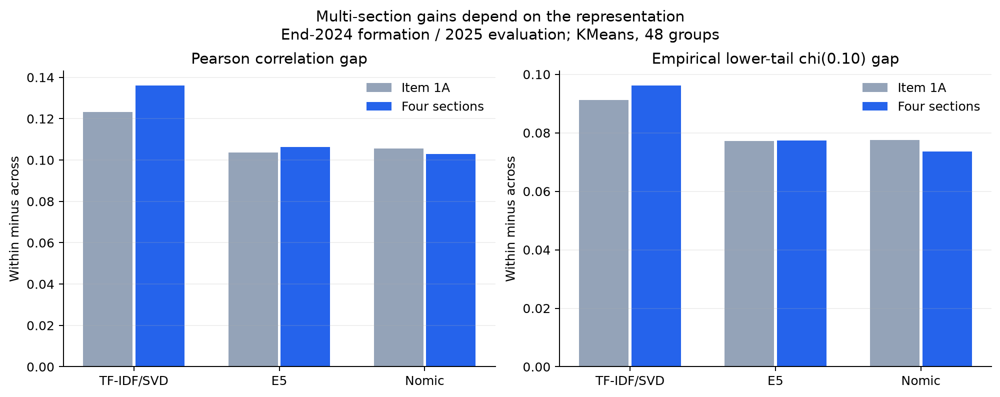
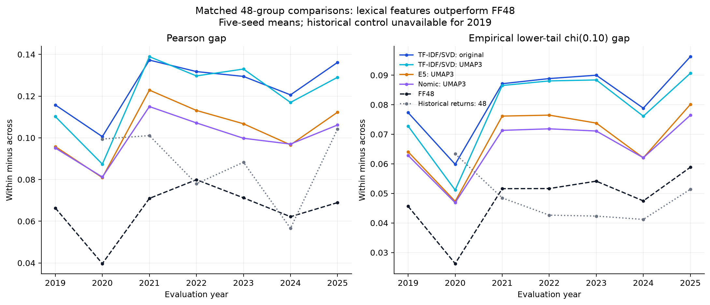

# Why use the text-classification framework?

## Research question and comparable evidence

The upstream TBIC study asks whether company text can group stocks with stronger within-group than across-group return dependence. The main descriptive statistic is **Gap = average within-group dependence - average across-group dependence**, with equal weights on supported stock pairs. Randomized method results average five fitted seeds. Seeds are not independent market samples.

The annual cohorts contain roughly 1,800-1,950 admitted issuers. End-2018 through end-2024 labels are evaluated on the **following year's daily total returns**, 2019-2025. Text fitting does not use that following year's returns. Nevertheless, choosing a method now after comparing those results is retrospective model selection, not an untouched out-of-sample investment experiment.

## 1. Four sections versus a single section

The four inputs are SEC 10-K **Item 1 (Business), Item 1A (Risk Factors), Item 7 (MD&A), and Item 7A (Market Risk)**. The lexical route uses a shared formation-year TF-IDF basis and 50-dimensional SVD, followed by normalized equal-weight fusion of the section vectors. Its Item 1A control shares the fitted lexical basis; it is not a wholly independently trained one-section vocabulary.

*Takeaway: four-section fusion improves both lexical gaps in the end-2024 / 2025 matched-48 experiment. E5's improvement is small; Nomic does not improve. More text is not uniformly better.*

| Lexical text input | Pearson Gap | Empirical lower-tail chi(0.10) Gap |
|---|---:|---:|
| Four sections | 0.136159 | 0.096257 |
| Item 1A only | 0.123152 | 0.091186 |

This supports the **lexical four-section choice in the reported setting**. It is not a seven-year multi-versus-single-text result, and does not establish the same advantage at every cluster resolution.

## 2. TF-IDF/SVD versus E5, Nomic and FF48

The stronger matched-count evidence compares the representations at **48 groups using KMeans**. Four-section original-space TF-IDF/SVD exceeds original-space E5, Nomic and FF48 on both Pearson and empirical lower-tail Gap in all seven years.

*Takeaway: both original-space and UMAP3 lexical KMeans48 exceed FF48 in all seven years on both metrics. UMAP is not a universal improvement over the original lexical representation.*

In particular, **TF-IDF/SVD + UMAP3 + KMeans48 beats FF48 in 7/7 years**, for Pearson and empirical lower-tail Gap. Thus the evidence is stronger than merely “most years” for those particular comparisons. It does not establish superiority over every other method. Original-space lexical KMeans48 has a higher Pearson Gap than its UMAP version in five of seven years.

## 3. Why UMAP3 + Leiden for the stock pool?

Among the nine four-section Leiden routes (three representations, each original / UMAP3 / PCA3), **TF-IDF/SVD + UMAP3 + Leiden has the highest Pearson Gap in every one of the seven years**. It also improves on direct lexical Leiden in all seven years.

*Takeaway: the lexical UMAP3 route is strong among the tested Leiden routes, but it produces different group counts. Its advantage is descriptive rather than a matched-count or portfolio-performance result.*

Leiden does not require a preselected `k`; communities emerge from a weighted nearest-neighbor graph under a resolution parameter. This is useful when seeking naturally occurring text groups rather than forcing exactly 48 industries. **It does not logically guarantee larger between-group distances or a better Gap.** Group count and size can themselves influence these comparisons.

Native lexical UMAP3-Leiden counts range from **25 to 35** across all years/seeds. The end-2024 representative partition has **30** classes. It was selected by highest mean ARI agreement with the other seeds, not by return outcomes or by trying to force 30 groups.

The same cohort's lexical original-space KMeans48 has a higher Pearson Gap than lexical UMAP3-Leiden in all seven years; the latter is therefore **not the global maximum-Gap algorithm**. We choose it as a useful native-community framework with strong descriptive evidence and a manageable number of candidate groups, not because it wins every possible comparison.

## 4. Comparison with historical-return clustering

The historical control uses three preceding calendar years, Pearson-based distances and average-linkage clustering, cut at 48 groups. Its original-window support is unavailable for the 2018 formation / 2019 evaluation; we do not replace it with a shorter history.

| Comparison against historical-return groups | Metric | Wins / comparable years |
|---|---|---:|
| Original lexical KMeans48 | Pearson | 6/6 |
| UMAP3 lexical KMeans48 | Pearson | 5/6 |
| UMAP3 lexical KMeans48 | Empirical chi(0.10) | 5/6 |
| UMAP3 lexical Leiden | Pearson | 5/6 |

Leiden's exception is the 2019 formation / 2020 evaluation: **0.081333** versus **0.099424** for historical-return groups. Also, the historical control can be extremely unbalanced: the end-2024 result has 1,790 of 1,910 companies in its largest group. Equal group counts do not ensure comparable group sizes.

## Interpretation boundaries

- FF48 is an industry benchmark, not ground-truth labels. These are not classification accuracy scores.
- Higher Gap can result from higher within-group dependence, not necessarily lower across-group dependence.
- No result here proves a more diversified selected portfolio, a larger Sharpe ratio or a CAPM verdict.
- The original study's uncertainty calibration had limitations; we make no formal statistical superiority claim.
- Early-year use of modern pretrained checkpoints does not establish their historical availability.
- Seed stability, cross-year membership persistence and next-year dependence Gap are different quantities.

## Report-ready rationale

> We use a text-based classification to construct a fixed research universe spanning distinct business groups. In a separate US company study, four-section TF-IDF/SVD showed stronger within-minus-across return-dependence gaps than FF48 and the tested pretrained representations in matched 48-group comparisons. The end-2024 single-section comparison also favored four-section fusion for the lexical method. Among nine native-count Leiden routes, the lexical UMAP3 route achieved the largest next-year Pearson gap in each of seven annual evaluations and exceeded a historical-return clustering control in five of six comparable years. We therefore adopt its end-2024 representative partition as a practical grouping framework. This is descriptive support for universe construction, not proof of superior portfolio performance; varying group counts, retrospective method selection and the historical sample's look-ahead and coverage restrictions remain explicit limitations.
