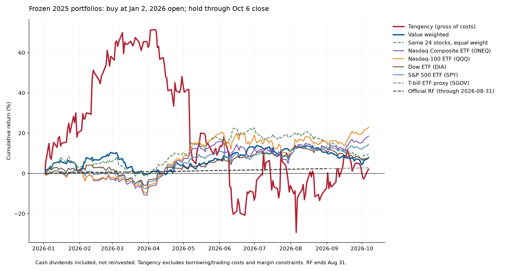

# 2026 retrospective out-of-estimation-sample tracking

Entry: January 2, 2026 official daily opening prices (January 1 holiday). End: October 6, 2026 close. Weights are frozen from the 108-month Stage 1 fit ending December 2025. No 2026 observations enter that fit. Fractional signed shares are permitted; no discretionary rebalancing. Dividends accrue as cash receivables on ex-dates, with zero interest and no reinvestment; short positions owe the same distributions. An ex-dividend date coinciding with entry does not earn a dividend.

## Results

| Portfolio / benchmark | Through | Return | Maximum drawdown |
|---|---|---:|---:|
| Tangency (gross of costs) | 2026-10-06 | 2.04% | -58.76% |
| Value weighted | 2026-10-06 | 7.89% | -10.00% |
| Same 24 stocks, equal weight | 2026-10-06 | 9.50% | -12.97% |
| Nasdaq Composite ETF (ONEQ) | 2026-10-06 | 18.50% | -12.68% |
| Nasdaq-100 ETF (QQQ) | 2026-10-06 | 22.88% | -11.72% |
| Dow ETF (DIA) | 2026-10-06 | 7.92% | -9.74% |
| S&P 500 ETF (SPY) | 2026-10-06 | 14.43% | -8.87% |
| T-bill ETF proxy (SGOV) | 2026-10-06 | 2.72% | 0.00% |
| Official RF (through 2026-08-31) | 2026-08-31 | 2.31% | 0.00% |

Main index comparisons use investable ETFs with distributions, not price-only indices. ONEQ tracks the Nasdaq Composite, QQQ the Nasdaq-100, DIA the Dow and SPY the S&P 500. ETF fees are embedded in observed prices. SGOV is a short-Treasury ETF proxy, not a guaranteed risk-free deposit. Official Ken French RF is compounded only through its last available observation, August 31; it is not extrapolated. The first RF day is the daily reference return, not a precisely time-matched intraday cash-account return.

## Mandatory corporate actions

- RYI becomes RYZ: existing Ryerson shares continue; the 1.7105 merger exchange ratio applies to Olympic shareholders, not our Ryerson holdings. Yahoo RYZ carries the predecessor history.

- HLX becomes HOS on September 2: old Helix shares convert 1:1. The 10.27167 ratio in the filing applies to legacy Hornbeck shares, not ours. Yahoo HOS carries predecessor history.

- CSGS last trades May 13 and converts to $80.70 cash on May 14. The settlement claim is recognized on closing and then held as non-interest-bearing cash; actual receipt delays are not modeled. The short position pays the consideration and terminates. No fabricated post-delisting stock prices.

- CSGS primary source: https://www.nasdaqtrader.com/TraderNews.aspx?id=ECA2026-319

- RYI primary source: https://www.sec.gov/Archives/edgar/data/1481582/000119312526051335/d29973dex991.htm

- HLX primary source: https://www.sec.gov/Archives/edgar/data/866829/000119312526378529/d102206d8k.htm

## Findings

The value-weighted basket returned 7.89%, close to the Dow ETF at 7.92%, below the Nasdaq Composite ETF at 18.50% and Nasdaq-100 ETF at 22.88%. The same basket equal-weighted returned 9.50%. The tangency allocation returned 2.04% before costs, with a 58.76% maximum peak-to-trough drawdown. Its largest negative ending-return contributions were HIW (-26.78 percentage points), VECO (-18.07) and BLMN (-12.53); positive contributions included URI (+22.88) and OSBC (+17.42). Thus this period gives no evidence that the optimized allocation improved realized performance. It does not by itself establish whether text clustering improves stock selection.

Price cross-check: nine names including all names with daily moves above 20% were compared with Massive across 191 sessions. The maximum closing-price difference across those comparisons was 0.241%; the large jumps are therefore not explained by a Yahoo-only price discrepancy. Minor vendor differences remain; they were not silently overwritten. See results/independent_price_checks.csv. Sources may share upstream exchange data, so this is corroboration rather than independent ground truth.

## Starting-capital downside versus peak-to-trough drawdown

The value-weighted basket briefly fell below its initial capital: minimum cumulative return -0.67%, with 8 negative closing observations. The Dow ETF reached -5.95%, with 25 negative closing observations. Thus the basket experienced a shallower and shorter loss relative to the entry capital in this observed period, while ending with a similar return. This is a favorable descriptive result. It is different from maximum drawdown, which measures losses from a running peak: value -10.00% versus Dow -9.74%. The chart does not show that the basket never lost money, and these results do not establish causal superiority of text clustering or future capital protection.

## Interpretation limits

This is retrospectively constructed out-of-estimation-sample performance, not a preregistered or strictly point-in-time strategy. Selection and method decisions were finalized in October 2026; Stage 1 capitalization has timing caveats, including subsequently corroborated shares. No claim is made that this exact portfolio was demonstrably available on December 31, 2025. The 2024 text universe and complete-history filters also induce selection effects.

A single selected basket versus broad indices cannot isolate the causal benefit of text clustering. The equal-weight same-basket diagnostic separates allocation choice from the chosen stocks only; it does not supply a random or sector-matched control universe. Large gross exposure confounds raw-return comparisons. Show drawdowns and contribution attribution alongside returns; do not interpret a win as proof of classification quality.

Tangency is an idealized signed-share ledger. It ignores borrow availability, stock-loan fees, taxes, execution slippage, margin calls and liquidation. Short-sale proceeds finance the long legs, and no interest/rebate is modeled. Borrow-fee scenarios apply hypothetical constant annual fees to lagged marked short notionals using calendar days and exclude entry-day intraday fees. They are not actual after-cost returns. If net equity reaches zero, subsequent frictionless values are not an investable survival path.

## Reproduction and data

Run `python backtest_2026.py` from this directory. No network or credentials are needed after cache creation. Yahoo daily chart responses provide split-adjusted OHLC and dividend events; no split events occur in this interval. Values use closes plus cash dividends, not adjusted closes plus dividends (which would double-count). CSGS data comes from cached Massive unadjusted bars and dividend responses. Cached sources retain raw numeric values. Main plots are arithmetic cumulative returns with a true entry-time baseline.

Source requests: Yahoo `/v8/finance/chart/{symbol}?period1=1767139200&period2=1791417600&interval=1d&events=div,splits`; Massive request URLs are archived without authentication. Ken French: https://mba.tuck.dartmouth.edu/pages/faculty/ken.french/ftp/F-F_Research_Data_Factors_daily_CSV.zip . Retrieved October 7, 2026.