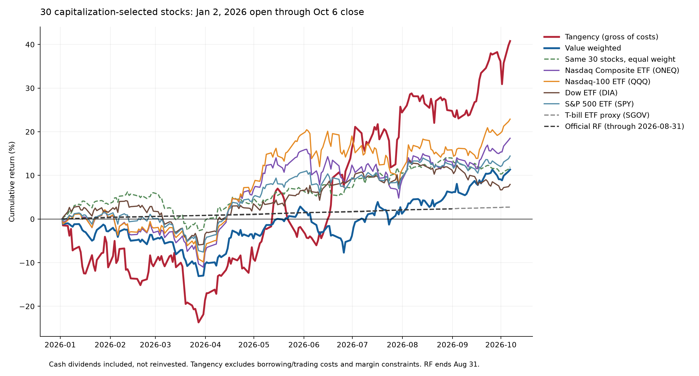

# 2026 tracking: 30-stock capitalization-selected universe

The universe consists of 30 stocks: one largest end-2024 company by vendor market cap among members with 108 complete monthly returns in each text class. Seven classes substitute the largest complete-history member. See [selection](../docs/03-universe-selection.md).

Entry is Jan 2, 2026 open; endpoint is Oct 6 close. Sample tangency and value weights are the Stage 1 weights, estimated through Dec 2025. This does not introduce 2026 returns into that estimation, but selection/method choices were made retrospectively in October 2026.

## Performance

| Portfolio | Through | Return | Max drawdown |
| --- | --- | --- | --- |
| Tangency (gross of costs) | 2026-10-06 | +40.78% | -23.70% |
| Value weighted | 2026-10-06 | +11.33% | -13.09% |
| Same 30 stocks, equal weight | 2026-10-06 | +11.93% | -8.40% |
| Nasdaq Composite ETF (ONEQ) | 2026-10-06 | +18.50% | -12.68% |
| Nasdaq-100 ETF (QQQ) | 2026-10-06 | +22.88% | -11.72% |
| Dow ETF (DIA) | 2026-10-06 | +7.92% | -9.74% |
| S&P 500 ETF (SPY) | 2026-10-06 | +14.43% | -8.87% |
| T-bill ETF proxy (SGOV) | 2026-10-06 | +2.72% | 0.00% |
| Official RF (through 2026-08-31) | 2026-08-31 | +2.31% | 0.00% |

[Ledoit–Wolf covariance comparison](ledoit_wolf/README.md) · [Text distance allocation comparisons](text_weight/README.md).

## Accounting and sources

All 30 stock legs use cached Massive unadjusted OHLC, dated split/stock-distribution factors and cash dividends. Split execution multiplies shares; ex-date cash is the then-current share quantity times cash_amount. Entry-day splits are already reflected in entry price and entry-day dividends are excluded. Cash is retained without interest or reinvestment; shorts owe cash distributions. Corporate actions and daily share/cash ledgers are exported. `validate.py` independently reconstructs the requested allocations and compares split-normalized Massive and Yahoo prices for all 30 names; see results/independent_price_checks.csv. This is cross-vendor corroboration, not independent exchange-level ground truth. No missing prices are filled; every stock must cover the common calendar. SF and SCCO have stock-count-changing events; no no-split assumption is made.

ETF benchmark curves retain the existing Yahoo split-adjusted price and matching cash-dividend convention and their original cached observations. There are no split events in those benchmark caches. Official French RF stops Aug 31, 2026; SGOV is a separate full-period T-bill ETF proxy. RF is not extrapolated. Daily RF is a reference convention, not an exact opening-to-closing cash-account return.

## Interpretation limits

This is retrospective out-of-estimation-sample tracking, not a preregistered or certified point-in-time strategy. Historical capitalization, 2024 grouping applied to earlier returns and complete-history screening retain their selection/timing limitations. Stock-versus-index comparisons do not isolate classification skill. Tangency is an idealized leveraged long/short ledger with no borrow availability, financing cost, trading cost, taxes or margin liquidation. Cash earns no interest. Borrow-fee scenarios are assumptions, not actual achieved net returns. No strategy is risk matched to another.

## Reproduce

From the repository root, run `python3 run_research_2026.py`. This refreshes Stage 1, replays the baseline and Ledoit–Wolf allocations, and validates the four report portfolios. Use `python3 run_research_2026.py --include-text` only to replay the additional historical SVD-space text allocation experiment; it is not the later three-dimensional UMAP-distance method and is not evidence used by the report. Dependencies: NumPy, pandas, scikit-learn, SciPy and Matplotlib. All calculation scripts are offline after cache creation. `fetch_sources.py` downloads only missing stock receipts and verifies Singapore egress before reading `MASSIVE_API_KEY` from the environment. Sanitized responses contain no authentication. Raw prices and corporate-action data remain subject to vendor limitations; this is not an independent audit of every record.
