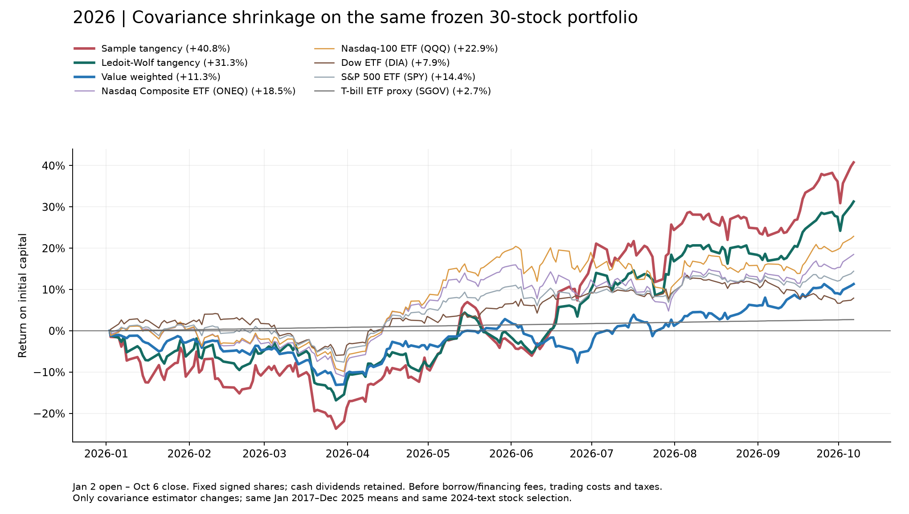
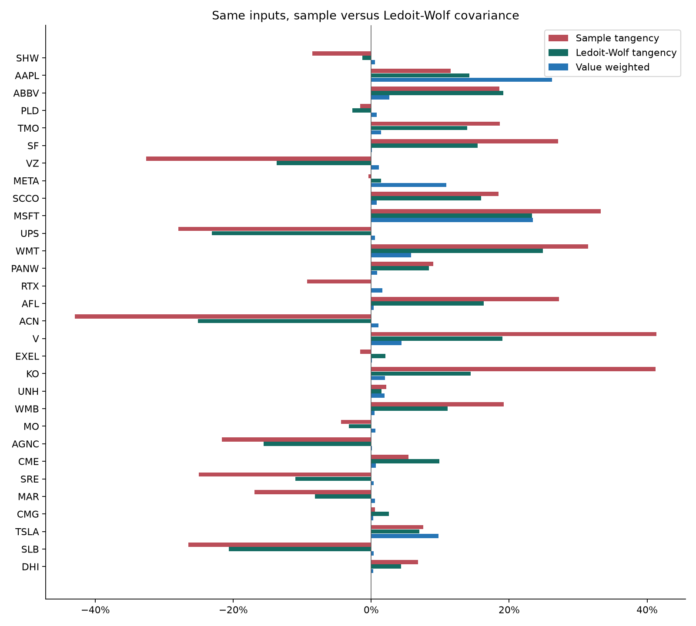

# Ledoit–Wolf: 30-stock universe

Same 108 monthly returns, unchanged excess-mean vector, Jan 2 open to Oct 6 close. Only covariance estimation changes relative to sample tangency. Scikit-learn scaled-identity shrinkage: Sigma=(1-alpha) S_MLE+alpha trace(S_MLE)/N I. Estimated alpha=0.129048. Weights normalize solve(Sigma,mean_excess); no clipping, mean shrinkage or leverage cap. Uniform covariance divisor scaling cancels in normalized weights.

| Portfolio | Gross exposure | Min weight | Max weight |
| --- | --- | --- | --- |
| Sample tangency | 5.389x | -42.96% | 41.36% |
| Ledoit-Wolf tangency | 3.494x | -25.12% | 24.90% |
| Value weighted | 1.000x | 0.08% | 26.22% |

## Performance

| Portfolio | Through | Return | Max drawdown |
| --- | --- | --- | --- |
| Value weighted | 2026-10-06 | +11.33% | -13.09% |
| Same 30 stocks, equal weight | 2026-10-06 | +11.93% | -8.40% |
| Nasdaq Composite ETF (ONEQ) | 2026-10-06 | +18.50% | -12.68% |
| Nasdaq-100 ETF (QQQ) | 2026-10-06 | +22.88% | -11.72% |
| Dow ETF (DIA) | 2026-10-06 | +7.92% | -9.74% |
| S&P 500 ETF (SPY) | 2026-10-06 | +14.43% | -8.87% |
| T-bill ETF proxy (SGOV) | 2026-10-06 | +2.72% | 0.00% |
| Official RF (through 2026-08-31) | 2026-08-31 | +2.31% | 0.00% |
| Sample tangency | 2026-10-06 | +40.78% | -23.70% |
| Ledoit-Wolf tangency | 2026-10-06 | +31.30% | -16.83% |

| Ticker | Sample tangency | Ledoit-Wolf tangency | Value weighted |
| --- | --- | --- | --- |
| SHW | -8.52% | -1.32% | 0.52% |
| AAPL | 11.53% | 14.23% | 26.22% |
| ABBV | 18.61% | 19.16% | 2.64% |
| PLD | -1.58% | -2.77% | 0.77% |
| TMO | 18.63% | 13.90% | 1.42% |
| SF | 27.09% | 15.40% | 0.08% |
| VZ | -32.64% | -13.72% | 1.12% |
| META | -0.41% | 1.40% | 10.86% |
| SCCO | 18.46% | 15.94% | 0.77% |
| MSFT | 33.25% | 23.32% | 23.46% |
| UPS | -27.97% | -23.09% | 0.55% |
| WMT | 31.42% | 24.90% | 5.80% |
| PANW | 8.96% | 8.34% | 0.84% |
| RTX | -9.30% | -0.03% | 1.61% |
| AFL | 27.22% | 16.28% | 0.38% |
| ACN | -42.96% | -25.12% | 1.08% |
| V | 41.36% | 19.04% | 4.41% |
| EXEL | -1.57% | 2.06% | 0.08% |
| KO | 41.24% | 14.44% | 1.96% |
| UNH | 2.20% | 1.48% | 1.95% |
| WMB | 19.20% | 11.10% | 0.48% |
| MO | -4.35% | -3.23% | 0.63% |
| AGNC | -21.67% | -15.60% | 0.08% |
| CME | 5.40% | 9.88% | 0.64% |
| SRE | -25.01% | -11.01% | 0.38% |
| MAR | -16.96% | -8.18% | 0.54% |
| CMG | 0.56% | 2.57% | 0.32% |
| TSLA | 7.54% | 6.96% | 9.76% |
| SLB | -26.50% | -20.63% | 0.37% |
| DHI | 6.76% | 4.31% | 0.27% |

This is a retrospective covariance sensitivity, not a risk-matched or preregistered test. All stock corporate-action accounting and limitations are inherited from [the main tracking ledger](../README.md). Costs and financing are excluded. Run `python compare.py`; all weights, covariance, means, contributions, daily paths and checks are saved here. No network needed.
