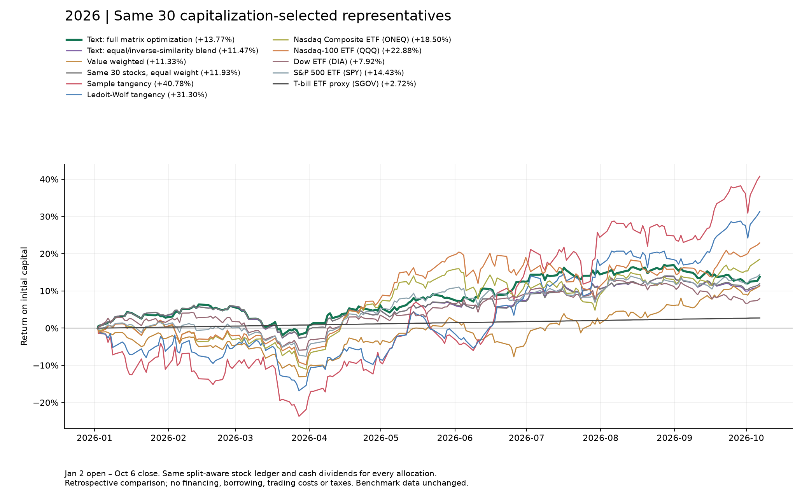
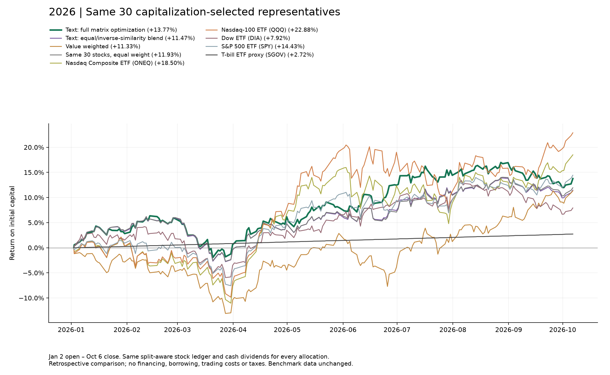

# Text allocations on the new 30-stock basket

Same stocks as main: largest end-2024 company cap among members with 108 complete monthly returns in each class. Recompute full-class centroids from normalized original 50D vectors (not UMAP display coordinates). One selected representative receives the entire class budget. No within-class softmax or new pruning.

Let D be pairwise cosine distance, h its off-diagonal median, and S=exp(-D/h), including diagonal 1. The earlier text rule is 0.5/K + 0.5*(1/row_sum(S))/sum(1/row_sum(S)). The full-matrix rule minimizes w^T S w with sum(w)=1 and 0.25/K <= w_i <= 2/K. K=30; bounds are 0.8333% and 6.6667%. They are explicit constraints, not return-tuned parameters. This similarity-sensitive diversity objective does not estimate return covariance or prove risk reduction.

All 30 original classes are represented; no submatrix or renormalization over only 24 classes remains. Both text allocations and the three financial allocations share the same 2026 split-aware economic paths.

## Performance

| Portfolio | Through | Return | Max drawdown |
| --- | --- | --- | --- |
| Value weighted | 2026-10-06 | +11.33% | -13.09% |
| Same 30 stocks, equal weight | 2026-10-06 | +11.93% | -8.40% |
| Nasdaq Composite ETF (ONEQ) | 2026-10-06 | +18.50% | -12.68% |
| Nasdaq-100 ETF (QQQ) | 2026-10-06 | +22.88% | -11.72% |
| Dow ETF (DIA) | 2026-10-06 | +7.92% | -9.74% |
| S&P 500 ETF (SPY) | 2026-10-06 | +14.43% | -8.87% |
| T-bill ETF proxy (SGOV) | 2026-10-06 | +2.72% | 0.00% |
| Official RF (through 2026-08-31) | 2026-08-31 | +2.31% | 0.00% |
| Sample tangency | 2026-10-06 | +40.78% | -23.70% |
| Ledoit-Wolf tangency | 2026-10-06 | +31.30% | -16.83% |
| Text: equal/inverse-similarity blend | 2026-10-06 | +11.47% | -8.39% |
| Text: full matrix optimization | 2026-10-06 | +13.77% | -7.80% |

## Weights

| Ticker | Sample tangency | Ledoit-Wolf tangency | Value weighted | Text: equal/inverse-similarity blend | Text: full matrix optimization |
| --- | --- | --- | --- | --- | --- |
| SHW | -8.52% | -1.32% | 0.52% | 2.95% | 0.83% |
| AAPL | 11.53% | 14.23% | 26.22% | 3.01% | 0.83% |
| ABBV | 18.61% | 19.16% | 2.64% | 3.84% | 6.67% |
| PLD | -1.58% | -2.77% | 0.77% | 3.66% | 6.67% |
| TMO | 18.63% | 13.90% | 1.42% | 3.10% | 0.83% |
| SF | 27.09% | 15.40% | 0.08% | 4.11% | 6.67% |
| VZ | -32.64% | -13.72% | 1.12% | 2.84% | 0.83% |
| META | -0.41% | 1.40% | 10.86% | 3.06% | 0.83% |
| SCCO | 18.46% | 15.94% | 0.77% | 3.01% | 0.83% |
| MSFT | 33.25% | 23.32% | 23.46% | 2.90% | 0.83% |
| UPS | -27.97% | -23.09% | 0.55% | 3.14% | 0.83% |
| WMT | 31.42% | 24.90% | 5.80% | 3.20% | 4.03% |
| PANW | 8.96% | 8.34% | 0.84% | 3.25% | 6.67% |
| RTX | -9.30% | -0.03% | 1.61% | 2.98% | 0.83% |
| AFL | 27.22% | 16.28% | 0.38% | 3.69% | 6.67% |
| ACN | -42.96% | -25.12% | 1.08% | 2.94% | 0.83% |
| V | 41.36% | 19.04% | 4.41% | 2.95% | 0.83% |
| EXEL | -1.57% | 2.06% | 0.08% | 4.15% | 6.67% |
| KO | 41.24% | 14.44% | 1.96% | 3.17% | 3.29% |
| UNH | 2.20% | 1.48% | 1.95% | 3.20% | 0.83% |
| WMB | 19.20% | 11.10% | 0.48% | 3.62% | 6.67% |
| MO | -4.35% | -3.23% | 0.63% | 2.98% | 0.83% |
| AGNC | -21.67% | -15.60% | 0.08% | 4.11% | 6.67% |
| CME | 5.40% | 9.88% | 0.64% | 3.25% | 2.40% |
| SRE | -25.01% | -11.01% | 0.38% | 3.69% | 6.67% |
| MAR | -16.96% | -8.18% | 0.54% | 3.24% | 2.25% |
| CMG | 0.56% | 2.57% | 0.32% | 3.89% | 6.67% |
| TSLA | 7.54% | 6.96% | 9.76% | 2.99% | 0.83% |
| SLB | -26.50% | -20.63% | 0.37% | 3.19% | 3.04% |
| DHI | 6.76% | 4.31% | 0.27% | 3.90% | 6.67% |

See [tracking accounting and limitations](../README.md). Retrospective universe/method choices, historical vendor cap uncertainty and excluded costs still apply. The same-basket comparison isolates weighting; it does not isolate classification skill. Run `python compare.py` with NumPy, pandas, SciPy and Matplotlib; all inputs are committed, no network required. Checks include convex optimum feasibility/KKT, weight sums, prior path replication and contribution reconciliation.
